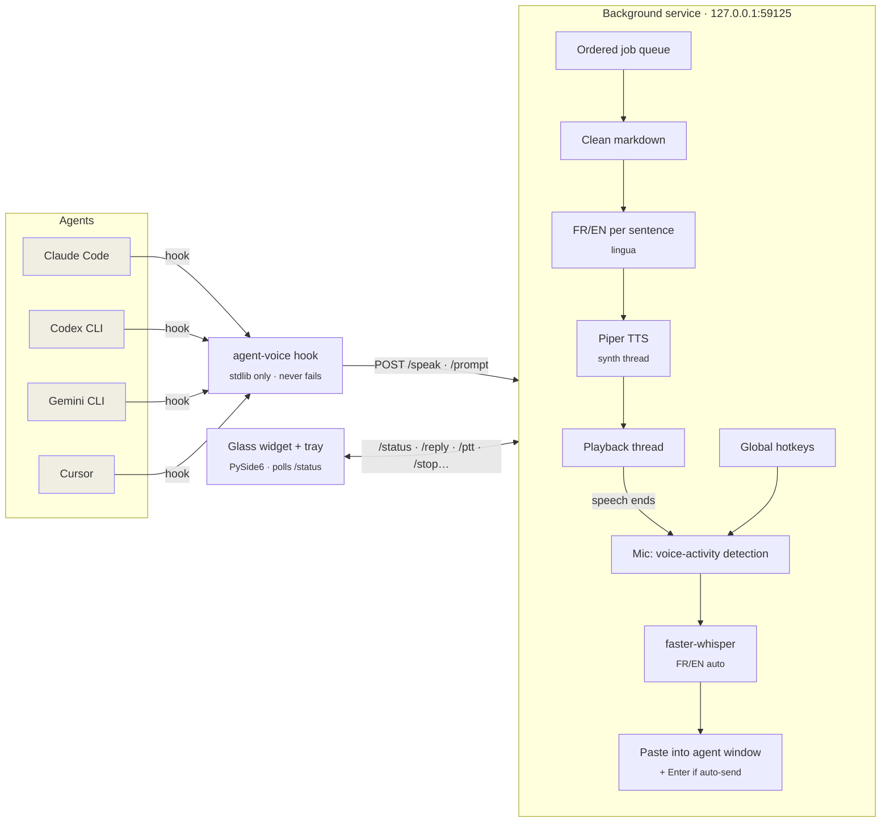
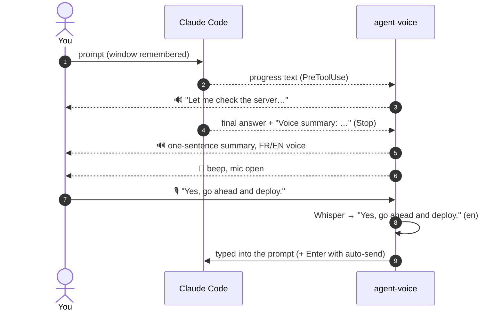

<p align="center">
  
</p>

<p align="center">
  <b>Hear your AI coding agent. Answer it by voice. In French or English. 100% on your machine.</b>
</p>

<p align="center">
  
  
  
  
  
</p>

<p align="center">
  <a href="#-quick-start">Quick start</a> ·
  <a href="docs/guide.md">User guide</a> ·
  <a href="#-the-widget">The widget</a> ·
  <a href="#-how-it-works">How it works</a> ·
  <a href="AGENTS.md">AGENTS.md</a>
</p>

---

**agent-voice** gives your coding agents a voice and ears. When Claude Code (or Codex, Gemini CLI, Cursor…) answers, you **hear** it, in a natural French or English voice picked sentence by sentence. When it's done, the mic opens: **just talk**, and your reply is transcribed and typed back into the agent's window, and sent too if you want. A small **glass widget** shows what's happening at a glance and puts every action one click away.

Everything runs **locally on the CPU**: no cloud, no API key, no audio leaving your laptop.

<p align="center">
  
  <br><sub>One full turn: the agent speaks → the mic opens → you answer → transcription → typed into the agent.</sub>
</p>

## ✨ Features

| | |
|---|---|
| 🗣️ **Speaks every reply** | Final answers *and* the short progress updates between tool calls, never twice. Markdown, code blocks, links and file paths are cleaned out so it sounds natural. |
| 📝 **Summaries, not essays** | Long final answers are spoken as one sentence. Claude Code is asked to end each reply with a `Voice summary:` line; other agents get the reply's opening sentences. Toggle for full answers anytime. |
| 🇫🇷 🇬🇧 **Bilingual, automatically** | Each sentence is language-detected and read by the matching voice. A reply mixing French and English switches voices mid-paragraph. |
| 🎙️ **Answer by voice** | After the reply, a beep and the mic opens for 15 s. Talk, pause, done: Whisper transcribes (FR/EN auto-detected) and types it into the window you prompted from. |
| ⏭️ **Skip to answer** | Don't wait for the end: `Ctrl+Alt+A` cuts the voice and listens immediately. |
| 📨 **Auto-send (hands-free)** | One toggle and your spoken replies are submitted for you. True hands-free pair programming. |
| ✋ **Push-to-talk anywhere** | Hold `Ctrl+Alt+Space` in any app to dictate. |
| 📖 **Read anything aloud** | Select text in any app (e.g. Antigravity) and press `Ctrl+Alt+R`. |
| 🪟 **Glass status widget** | Acrylic, always on top, draggable, never steals focus. Animated orb, aurora and live waveform for every state. |
| 🔔 **Tray icon** | Lives next to the clock, changes colour with the state; show/hide the widget and reach every action. |
| ⚡ **Light & instant** | Piper synthesizes ~11× faster than real time on CPU; models stay loaded in a small background service. |
| 🔒 **Private & safe** | 100% offline; the local API rejects web pages, DNS rebinding and oversized requests. |

## 🚀 Quick start

### Download (Windows, no Python needed)

1. Get **`agent-voice-windows-x64.zip`** from the [latest release](https://github.com/ElMastho/agent-voice/releases/latest) and extract it anywhere (e.g. `C:\Toolsgent-voice`).
2. Double-click **`agent-voice.exe`**. The first run downloads the voices and the speech-recognition model (~600 MB), hooks into the agents it finds (Claude Code, Codex, Gemini CLI, Cursor) and starts the widget.
3. Optional: `agent-voice.exe autostart on` (or tray icon → *Start with Windows*).

Hooks point at the folder you extracted to: if you move it, double-click `agent-voice.exe` again.

### From source

> Windows 11 · Python 3.13 recommended (some audio/ML wheels lag behind the newest Python).

```bash
git clone https://github.com/ElMastho/agent-voice.git
cd agent-voice
py -3.13 -m venv .venv
.venv/Scripts/pip install -e .
.venv/Scripts/agent-voice setup              # config + voices + speech-recognition model (~600 MB)
.venv/Scripts/agent-voice install claude     # or: codex gemini cursor | all
.venv/Scripts/agent-voice autostart on       # start with Windows (service + widget + tray icon)
.venv/Scripts/agent-voice start
```

Then open a **new** Claude Code session and ask it anything. You'll hear the answer, then a beep: reply out loud. The full walkthrough is in the **[user guide](docs/guide.md)**.

## 🪟 The widget

<p align="center">
  
</p>

| State | What you see | Main button |
|---|---|---|
| **Ready** | Slate orb, slow breathing | 🎙️ talk now |
| **Speaking** | Violet orb with ripples, FR/EN badge, waveform follows the voice | ⏭️ skip & answer |
| **Listening** | Green pulse; `AUTO` badge when auto-send is on | ⏹️ cancel |
| **Hearing you** | Ring and waveform follow your voice level | ⏹️ cancel |
| **Transcribing** | Amber orb with a spinning arc, pulse sweeping the waveform | — |
| **Muted** / **Offline** | Red / grey orb | 🎙️ talk / ⏻ start the service |


Open the chevron for **every action with its shortcut**: reply now, hold to talk, stop, auto-send, mute, read selection, plus the voice speed and the **Voice / Chimes** mode. The **Recent** list shows the last 5 things it heard from you, with their language: click one to copy it again.

- **Drag** it anywhere: it snaps to screen edges and remembers its place.
- **Discreet**: it fades when idle and lights up when something happens.
- **Never steals focus**: clicking it keeps your agent window active.
- **Hide / show**: `Ctrl+Alt+W`, a click on the tray icon, or right-click → *Hide widget*.
- **Compact**: right-click → *Compact (orb only)* shrinks it to the animated orb; a click on it talks / cancels / skips.
- **Replies go back to your agent**: dictated replies are typed into the window you last prompted from, even if it is minimized or behind another app; once sent (auto-send), you're returned to where you were. In the Claude desktop app it also opens the right conversation in the sidebar first, so a reply never lands in another thread. The text also stays on the clipboard.
- **Tray menu**: every action, auto-send/mute toggles, start/stop the service, *Start with Windows*.

<br clear="right">

## ⌨️ Shortcuts

| Keys | Action |
|---|---|
| `Ctrl+Alt+A` | **Reply now**: stop the voice and listen for your answer |
| `Ctrl+Alt+Space` *(hold)* | **Push-to-talk** in any window |
| `Ctrl+Alt+S` | **Stop** speaking / listening |
| `Ctrl+Alt+H` | **Auto-send** on/off (the voice confirms) |
| `Ctrl+Alt+M` | **Mute** on/off |
| `Ctrl+Alt+C` | **Chime mode** on/off: no voice, a soft sound when the agent is done or needs you |
| `Ctrl+Alt+R` | **Read** the selected text aloud |
| `Ctrl+Alt+W` | **Show / hide** the widget |

All of them can be changed in `~/.agent-voice/config.json`.

## 🤖 Supported agents

| Agent | Integration | Install |
|---|---|---|
| **Claude Code** (CLI, desktop, IDE) | `Stop`, `PreToolUse` and `UserPromptSubmit` hooks: progress + final answer, reply window tracking | `agent-voice install claude` |
| **Codex CLI** | top-level `notify` in `~/.codex/config.toml` | `agent-voice install codex` |
| **Gemini CLI** | `AfterAgent` hook in `~/.gemini/settings.json` | `agent-voice install gemini` |
| **Cursor** | `afterAgentResponse` in `~/.cursor/hooks.json` | `agent-voice install cursor` |
| **Antigravity** / anything else | select + `Ctrl+Alt+R`, or `echo text \| agent-voice say` | none needed |

Installers back up the file they touch (`*.bak-agent-voice`), are idempotent, and `agent-voice uninstall <agent>` reverts them.

## 🧠 How it works





## ⚙️ Configuration

`~/.agent-voice/config.json` (created by `agent-voice setup`, merged over defaults):

| Key | Default | Meaning |
|---|---|---|
| `voices.en` / `voices.fr` | `en_US-hfc_male-medium` / `fr_FR-siwis-medium` | Any [Piper voice](https://huggingface.co/rhasspy/piper-voices); `name:speaker` for multi-speaker models. Downloaded on first use |
| `speed` | `0.67` | Piper length scale: `1.0` normal, lower is faster |
| `max_chars` | `1500` | Long replies are cut at a sentence boundary |
| `speak_progress` | `true` | Also speak Claude's messages between tool calls |
| *(runtime)* speed | `1.5×` | Voice speed 1× to 2×: widget panel, tray → *Voice speed*, or `agent-voice speed 1.75` |
| `summary` | `enabled: true`, `max_chars: 280` | Speak a one-sentence summary of final answers (runtime toggle: tray or `agent-voice summary`) |
| `auto_listen` | `enabled`, 15 s window, 1.5 s silence, 600 s max | Mic after the final answer |
| `chime.volume` | `0.35` | Chime mode loudness (0 to 1): a rising chime when done, a double one for questions and permissions |
| `stt.model` | `small` | Whisper size: `base` is faster, `small` is better in French |
| `widget` | `enabled: true`, `blur: "acrylic"` | `blur`: `acrylic` / `blur` / `none` |
| `hotkeys.*` | see above | Any [keyboard](https://github.com/boppreh/keyboard) combination |

Restart after editing: `agent-voice shutdown && agent-voice start`.

## 🧰 Commands

```text
agent-voice start | shutdown | status          run / stop / inspect the background service
agent-voice say "text" [--lang fr|en] [--voice NAME]
agent-voice stop | mute [on|off|toggle] | unmute | handsfree [on|off|toggle] | summary [on|off|toggle] | speed [1-2]
agent-voice chime [on|off|toggle]               chime mode: sounds only, for open-plan offices
agent-voice widget                              reopen the widget + tray icon
agent-voice install | uninstall [claude codex gemini cursor | all]
agent-voice autostart on|off                    start with Windows
agent-voice setup                               config, voices, Whisper model
agent-voice serve                               run in the foreground (debugging)
```

## 🔒 Privacy & security

- **Offline by design**: text-to-speech, transcription and language detection all run locally. Audio never leaves the machine.
- **Local API only**: the service listens on `127.0.0.1` and rejects any request carrying an `Origin` header, a foreign `Host` (DNS rebinding) or a non-JSON body. Web pages can't drive it.
- **Clipboard-safe**: dictation pastes via the clipboard and restores what you had copied.
- **Agent-safe**: hooks are stdlib-only, time-boxed and swallow their own errors. A voice problem never breaks your agent.

## 🧪 Development

```bash
.venv/Scripts/pip install -e ".[dev]"
.venv/Scripts/python -m pytest -q             # unit tests
.venv/Scripts/agent-voice serve               # service in the foreground, logs in the console
.venv/Scripts/python scripts/render_docs.py   # regenerate the README images from the widget code
```

Architecture notes, invariants and gotchas for contributors (human or AI) are in **[AGENTS.md](AGENTS.md)**.

## 🙏 Built with

| Project | Role | License |
|---|---|---|
| [Piper](https://github.com/OHF-Voice/piper1-gpl) (`piper-tts`) | Neural text-to-speech | GPL-3.0-or-later |
| [Piper voices](https://huggingface.co/rhasspy/piper-voices) | Voice models (`hfc_male`, `siwis`…) | Per voice: see each model card |
| [faster-whisper](https://github.com/SYSTRAN/faster-whisper) | Speech-to-text | MIT |
| [CTranslate2](https://github.com/OpenNMT/CTranslate2) | Whisper inference engine | MIT |
| [OpenAI Whisper](https://github.com/openai/whisper) | Speech recognition model weights | MIT |
| [ONNX Runtime](https://github.com/microsoft/onnxruntime) | Runs the Piper models | MIT |
| [Lingua](https://github.com/pemistahl/lingua-py) | French/English detection | Apache-2.0 |
| [PySide6 / Qt](https://doc.qt.io/qtforpython-6/) | Widget and tray icon | LGPL-3.0 |
| [sounddevice](https://github.com/spatialaudio/python-sounddevice) | Audio playback & recording | MIT |
| [keyboard](https://github.com/boppreh/keyboard) | Global hotkeys | MIT |
| [pyperclip](https://github.com/asweigart/pyperclip) | Clipboard | BSD-3-Clause |
| [py3langid](https://github.com/adbar/py3langid) | Language detection in the Windows release (lingua is too large to bundle) | BSD-3-Clause |
| [comtypes](https://github.com/enthought/comtypes) | UI Automation: open the right conversation in the Claude desktop app | MIT |
| [NumPy](https://numpy.org) | Audio buffers | BSD-3-Clause |
| [Segoe Fluent Icons](https://learn.microsoft.com/windows/apps/design/style/segoe-fluent-icons-font) | Widget icons (system font, not redistributed) | Microsoft |

## 📄 License

Copyright © 2026 ElMastho.

agent-voice is free software: you can redistribute it and/or modify it under the terms of the **GNU General Public License v3.0 or later**. See [LICENSE](LICENSE). It is distributed in the hope that it will be useful, but **without any warranty**. GPL-3.0 is used because agent-voice builds on Piper, which is itself GPL-3.0. Voice models keep their own licenses.
