<p align="center">
  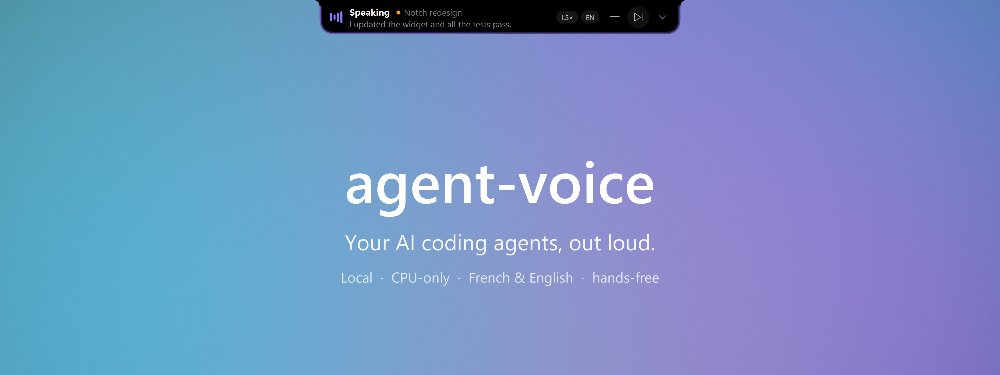
</p>

<p align="center">
  <b>Hear your AI agents. Answer them by voice. Follow every one of them from a notch at the top of your screen.<br>Claude Code, Codex, Gemini, Cursor, Antigravity, ChatGPT in the browser... French or English, 100% on your machine.</b>
</p>

<p align="center">
  
  
  
  
  
</p>

<p align="center">
  <a href="#-quick-start">Quick start</a> ·
  <a href="#-the-notch">The notch</a> ·
  <a href="#-talking-to-your-agents">Talking to your agents</a> ·
  <a href="docs/guide.md">User guide</a> ·
  <a href="#-how-it-works">How it works</a> ·
  <a href="AGENTS.md">AGENTS.md</a>
</p>

---

**agent-voice** gives your AI agents a voice and ears, and puts all of them in one place: a black notch at the top of your screen. When Claude Code, Codex, Gemini CLI, Cursor, Cline, Antigravity, Claude Desktop, VS Code, ChatGPT or Claude in the browser, or any terminal agent answers, you **hear** it in a natural French or English voice and **read along** under the notch. While they work, a dot per conversation shows who's busy and who **needs you**; approve or answer from the notch, by voice or with a click. When an answer ends, the mic opens: **just talk**, and your reply goes back to the right conversation. Or send a message to any of them by name: *"Hey Claude, tell Codex to run the tests."*

Everything runs **locally on the CPU**: no cloud, no API key, no audio leaving your laptop. It's built to sip battery: nothing redraws or polls while nothing happens.

<p align="center">
  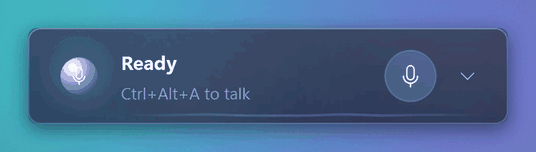
  <br><sub>One turn: the agent works → reads its answer → the mic opens → you reply → the notch tucks itself away.</sub>
</p>

## ✨ Highlights

| | |
|---|---|
| 🏝️ **Every agent, one notch** | Hooks (Claude Code, Codex, Gemini CLI, Cursor, Cline), an **MCP server** (Antigravity, Claude Desktop, Windsurf, VS Code...), a **browser extension** (ChatGPT, Claude, Gemini, AI Studio, Perplexity, Copilot), **`agent-voice watch`** for any terminal agent, and desktop apps' notifications. |
| 🙋 **Needs you** | Approvals, questions and agents waiting for input, from every agent, in one list: *Allow* / *Deny* with a click, or say *"approve Codex"*. |
| 🔵 **A dot per conversation** | Who's working, who waits on you, who just finished, at a glance; click a dot to jump to it. |
| 🗂️ **While you were away** | Back at your desk (or out of a call): *"Notch redesign finished; Codex needs you."* |
| ➕ **Start a new thread** | `Ctrl+Alt+N`, *+ New* in the panel, or *"Hey Claude, new thread: add a health check"*: a new Claude Code session in the desktop app, or Claude Code / Codex / Gemini CLI in a new terminal tab. |
| 📣 **Talk to any thread by name** | *"Tell Codex to run the tests"* is typed into Codex's window and sent, wherever you are. |
| 📊 **Results and usage** | *Done · 3 files changed · tests passed*, each conversation's context, Claude's 5-hour and weekly limits. |
| 📎 **Drop files on the notch** | Screenshots, logs, files: dropped on the notch, they land in the conversation's prompt. |
| 🗣️ **Speaks every reply** | Final answers and the progress notes between tool calls, never twice. Markdown, code and paths are cleaned out so it sounds natural. |
| 📖 **Read along** | The text being spoken hangs under the notch, from the sentence you're hearing, and leaves when the voice stops. |
| ⏱️ **Live activity** | While an agent works: *Working · Edit widget.py · 14 steps* and a timer, like a Dynamic Island. |
| 📝 **Summaries, not essays** | Long answers become one sentence (Claude Code is asked for a `Voice summary:` line). Full answers are one click away. |
| 🎙️ **Answer by voice** | After the answer, a beep and the mic opens. Talk, pause, done: Whisper transcribes and your reply is typed (and sent, with auto-send) into the conversation it answers. |
| 🧵 **Several conversations** | Each one has its colour, its own voice pitch and its own window; a second one waits its turn and is announced by name. |
| 🔔 **Voice, Chimes or Silent** | In the office: a soft chime and the reply as a banner. In a call: chimes, automatically. |
| ✅ **Approvals & questions** | Claude's permission prompts and multiple-choice questions, read out and shown in the notch: say *"yes"* or *"the second one"*, or click. |
| 👋 **"Hey Claude"** | Optional wake word: *"Hey Claude, run the tests"* sends a new prompt, hands-free. |
| 🇫🇷 🇬🇧 **Bilingual** | Each sentence is read by the matching voice; Whisper detects which language you speak. |
| 🔒 **Private, light, safe** | 100% offline; a local API that web pages can't reach; hooks that never break your agent. |

## 🚀 Quick start

### Download (Windows, no Python needed)

1. Get **`agent-voice-windows-x64.zip`** from the [latest release](https://github.com/ElMastho/agent-voice/releases/latest) and extract it anywhere (e.g. `C:\Tools\agent-voice`).
2. Double-click **`agent-voice.exe`**. The first run downloads the voices and the speech-recognition model (~600 MB), connects the agents it finds and starts the notch.
3. Optional: `agent-voice.exe autostart on` (or tray icon → *Start with Windows*).
4. Optional: ChatGPT, Claude or Gemini in the browser: `agent-voice.exe install browser`, then load the extension (see [the browser](#in-the-browser)).

Hooks point at the folder you extracted to: if you move it, double-click `agent-voice.exe` again. You can also connect an agent later from the notch: expand it and click the agent in the **Agents** row.

### From source

> Windows 11 · Python 3.13 recommended (some audio/ML wheels lag behind the newest Python).
> **macOS (beta)**: the same steps with `python3.13 -m venv .venv` and `.venv/bin/...`. Give your terminal the *Accessibility* permission (global shortcuts, typing your replies). The test suite runs on macOS in CI; the app itself is less tried there than on Windows.

```bash
git clone https://github.com/ElMastho/agent-voice.git
cd agent-voice
py -3.13 -m venv .venv
.venv/Scripts/pip install -e .
.venv/Scripts/agent-voice setup              # config + voices + speech-recognition model (~600 MB)
.venv/Scripts/agent-voice install claude     # or: codex gemini cursor cline antigravity claude-desktop windsurf vscode browser | all
.venv/Scripts/agent-voice autostart on       # start with Windows (service + notch + tray icon)
.venv/Scripts/agent-voice start
```

Then open a **new** Claude Code session and ask it anything. You'll see it work in the notch, hear the answer, then a beep: reply out loud. The full walkthrough is in the **[user guide](docs/guide.md)**.

## 🏝️ The notch

agent-voice lives in a pure-black island at the top centre of your screen. At rest it tucks itself away, leaving a 3-pixel line: touch the top edge with the mouse to bring it down. It drops down on its own when something happens, and goes back up 3 seconds after. Covering something while an agent works? The **—** button tucks it away until there's news (a voice, a question, something that needs you, a new reply).

<p align="center">
  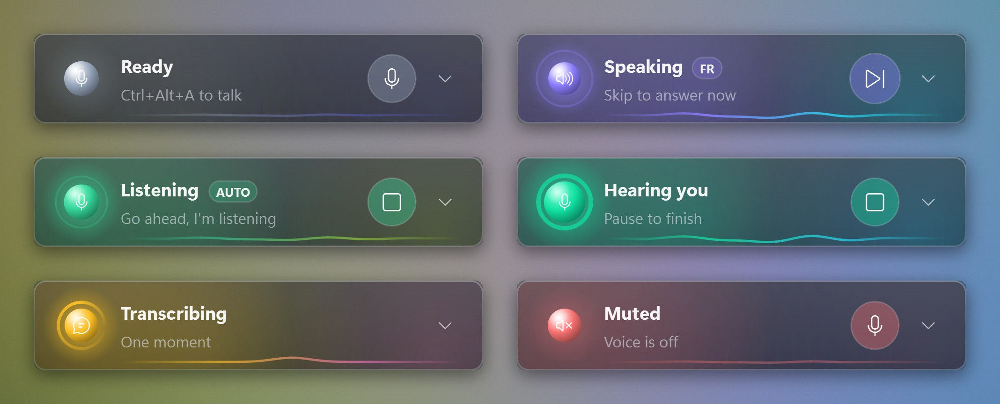
</p>

| State | What you see | Main button |
|---|---|---|
| **Ready** | A slate dot and what you said last | 🎙️ talk now |
| **Working** | Three dots ticking in the conversation's colour, the current step, a timer, *+1 working* for the others | 🎙️ talk now |
| **Speaking** | Bars following the voice, a violet light running around the edge, the language | ⏭️ skip & answer |
| **Hearing you** | Bars following your voice level, a green edge light; *Auto* when replies are sent for you | ⏹️ cancel |
| **Transcribing** | A spinning amber arc; *+1 waiting* when another conversation is next | — |
| **In a call** / **Chime** / **Silent** | A chip saying which mode you're in | 🎙️ talk now |

The edge light only shows while the voice or the mic is live: it doubles as a "mic on" signal.

### Every agent at a glance

<p align="center">
  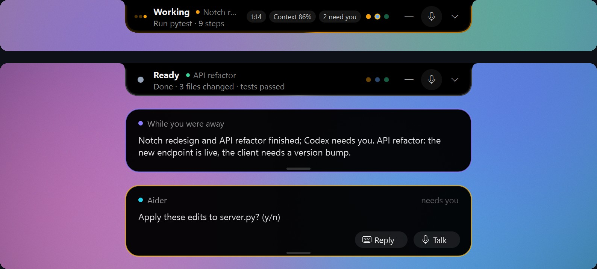
</p>

- **A dot per live conversation**, in its colour, on the right of the notch: filled while it works or talks, ringed in amber while it waits on you, dimmed once it's done. Hover for its name and state, click to open it.
- **N need you**: approvals, questions and agents waiting for input, from every agent. The panel lists them with *Allow* / *Deny* (or *Open* for those you answer in their own window), and you can answer by voice: *"approve Codex"*, *"deny the notch one"*, *"yes"*.
- **What the turn changed**: when a conversation finishes, *Done · 3 files changed · tests passed* (from the files it edited and its last test run); click it to open the conversation.
- **Context**: *Context 86%* when the conversation at work is running out of context; each thread shows its own.
- **While you were away**: after 5 minutes without touching the keyboard or mouse, or at the end of a call, a violet banner (spoken in Voice mode) tells you what finished and who needs you.
- **Drop files**: drag screenshots, logs or files onto the notch (or onto a thread in the panel): their paths are typed into that conversation's prompt, not sent, so you can add your question.

### Read along

<p align="center">
  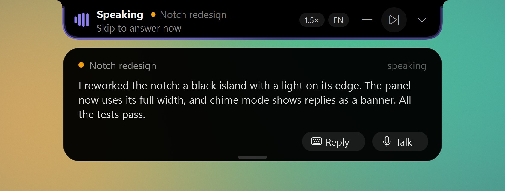
</p>

While a reply is read out, its text hangs under the notch, starting at the sentence you're hearing, and disappears when the voice stops. Swipe it up to hide it for this reply; click it to open the conversation. (`read_along: false` turns it off.)

### What you said, before it goes

<p align="center">
  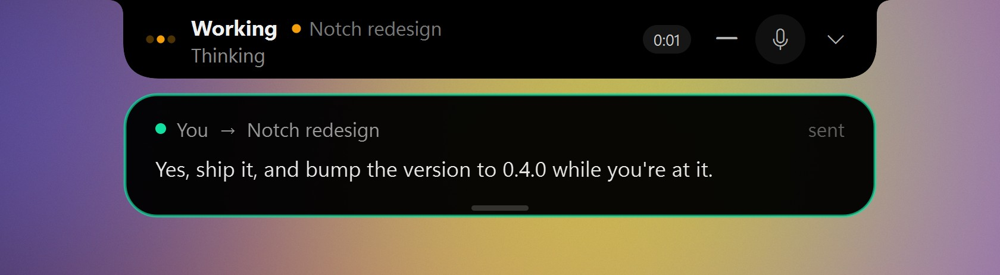
</p>

Once your reply is transcribed, it drops down under the notch framed in green, the colour of your voice, so it's never mistaken for the agent's text: who it goes to, and whether it was **sent** (auto-send), **typed** into the prompt for you to check, taken as an **answer** to a question or approval, or as a **command**.

### Chimes and Silent: the reply as a banner

<p align="center">
  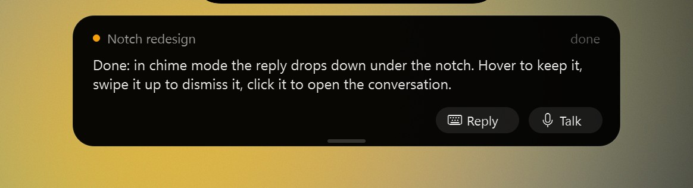
</p>

In **Chimes** (a soft sound) or **Silent** (no sound at all), nothing talks, not even a setting change. Each finished reply drops down as a banner for about 5 seconds: hover to keep it, swipe it up to dismiss it, click it to open the conversation. **Reply** opens a box under the notch to type your answer (Enter sends it to that conversation, wherever its window is); **Talk** opens the mic for it. Both are on the read-along banner too. While **another app holds the mic** (Teams, Zoom, Meet...), agent-voice switches to chimes by itself and back when the call ends; pick *Voice* during the call to override it.

### Every action, one click away

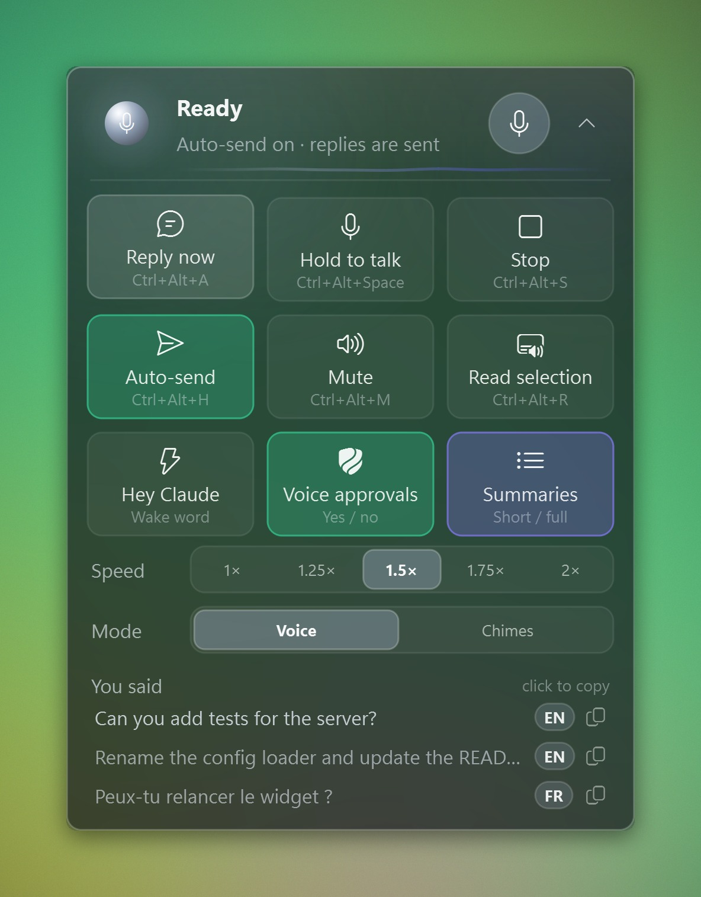

Open the chevron for the full panel:

- **Actions** with their shortcuts: reply now, hold to talk, stop, auto-send, silent, read selection, *Hey Claude*, approvals, summaries, and the last reply's **Replay**, **Copy** and **Open chat**. Buttons that only matter for the voice hide themselves in Chimes and Silent.
- **Speed** (1× to 2×) and **Mode**: *Voice / Chimes / Silent*.
- **Threads**: your recent conversations, what each is doing (*working*, *speaking*, *asks you*, *needs approval*, *waiting for you*, *next up*), what its last turn changed, its context, and the start of its last reply. Its buttons: 🎙️ **talk to it** (what you say is sent to that conversation), ⌨️ **type to it**, replay and copy. Click the row to open it. With `agent-voice usage on`, Claude Code's 5-hour and weekly limits show in the header.
- **You said**: the last 5 things it heard from you; click to copy.
- **Needs you** (when something waits on you): approve, deny or open, for every agent.
- **Agents**: which agents are connected (green dot): Claude Code, Codex, Gemini CLI, Cursor, Cline, Antigravity, the Claude desktop app, Windsurf, VS Code and the browser. Click one that isn't to connect it, or **?** for the setup guide.

The notch **never takes keyboard focus**, so your dictated reply still lands in the right window. It stays above your other windows.

<br clear="right">

### Prefer it floating?

<p align="center">
  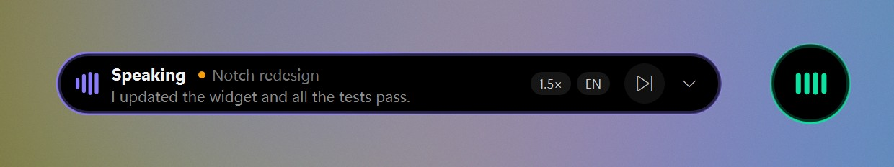
</p>

Right-click the notch → *Float the widget again*: the same black island, rounded all round, that you drag anywhere (it snaps to edges and remembers its place), with the same edge light, read-along, banners and panel. *Compact* shrinks it to a black orb with the same state mark; a click on it talks, cancels or skips. `Ctrl+Alt+W` or a click on the tray icon shows / hides it.

## 💬 Talking to your agents

- **Reply**: after each answer the mic opens for 15 s (`Ctrl+Alt+A` to skip the voice and answer right away). Your reply goes to the window and the conversation it answers, even if it's minimized or another app is in front; once sent, you're returned to where you were. In the **Claude desktop app**, with auto-send on, it's sent **without bringing the app forward**. The text also stays on the clipboard.
- **Auto-send** (`Ctrl+Alt+H`): your spoken replies are submitted for you.
- **Push-to-talk** (hold `Ctrl+Alt+Space`): dictate into any app.
- **Voice commands** in the reply window: *"repeat that"*, *"slower"*, *"faster"*, *"never mind"* (or *"répète"*, *"plus lentement"*, *"plus vite"*, *"annule"*) drive agent-voice instead of being sent.
- **Approvals**: when Claude Code asks to run a command or edit a file, the request is read out and shown with *Allow once* / *Deny*. Say *"yes"* / *"no"* (*"oui"* / *"non"*) or click; with no answer within a minute, Claude shows its own dialog. Voice never grants more than once. Several agents can ask at once: the first is read out, the others wait in **Needs you**, and *"approve Codex"* answers the one you name.
- **New threads**: `Ctrl+Alt+N` (or *+ New* in the panel's Threads, or the tray) opens a box under the notch: pick where it runs (**Claude app**: a new Claude Code session in the desktop app, in your folder's group; or **Claude Code**, **Codex**, **Gemini CLI** in a new Windows Terminal tab), check the folder (the one you last worked in), then type the first prompt or press **Talk** and say it. By voice: *"Hey Claude, new thread: add a health check"*, *"start a new conversation with Codex to …"*, *"nouvelle session : …"*. From a script: `agent-voice new "prompt" [--agent claude-app|claude|codex|gemini] [--cwd DIR]`.
- **Messages by name**: *"Hey Claude, tell Codex to run the tests"* (or *"dis à Codex de lancer les tests"*, or in the reply window *"tell the notch redesign to commit"*) types *"Run the tests"* into that conversation's own window, sends it, and brings you back.
- **Questions**: when the agent asks you to choose (Claude Code's questions, Cline's follow-ups), the options appear in the notch and are read out. Click one or say it: *"the second one"*, *"option 3"*, or its name; anything else is sent as your own answer.
- **Several conversations**: when a second one finishes while another is talking (or waiting for you), it waits its turn and is announced by name. Each speaks a little lower or higher than the others (`thread_voices`), so you can tell them apart without looking.
- **Hey Claude** (off by default, toggle in the panel): while idle, *"Hey Claude, run the tests"* is sent to your last conversation as a new prompt; *"Hey Claude"* alone opens the mic. A 3.3M-parameter keyword spotter ([sherpa-onnx](https://github.com/k2-fsa/sherpa-onnx)) listens only while someone speaks, so it costs next to nothing; short phrases it misses (an accent it doesn't know: "Klod") get a quick check by Whisper tiny, and Whisper confirms every phrase before anything is sent.
- **Read anything aloud**: select text in any app and press `Ctrl+Alt+R`.
- **Updates**: when a newer release is on GitHub, the tray menu offers it and the notch shows an *Update* chip.

## ⌨️ Shortcuts

| Keys | Action |
|---|---|
| `Ctrl+Alt+A` | **Reply now**: stop the voice and listen for your answer |
| `Ctrl+Alt+Space` *(hold)* | **Push-to-talk** in any window |
| `Ctrl+Alt+S` | **Stop** speaking / listening |
| `Ctrl+Alt+H` | **Auto-send** on/off |
| `Ctrl+Alt+C` | **Chimes** on/off |
| `Ctrl+Alt+M` | **Silent** on/off |
| `Ctrl+Alt+R` | **Read** the selected text aloud |
| `Ctrl+Alt+W` | **Show / hide** the notch |
| `Ctrl+Alt+N` | **New thread**: type or say its first prompt |

All of them can be changed in `~/.agent-voice/config.json`.

## 🤖 Supported agents

| Agent | How it connects | Install |
|---|---|---|
| **Claude Code** (CLI, desktop, IDE) | `Stop`, `PreToolUse`, `UserPromptSubmit`, `Notification` and `PermissionRequest` hooks: progress, live activity, final answer, questions, approvals, files changed and tests, context | `agent-voice install claude` |
| **Codex CLI** | `notify` in `~/.codex/config.toml`, plus the MCP server (live status, questions) | `agent-voice install codex` |
| **Gemini CLI** | `AfterAgent` and `Notification` hooks in `~/.gemini/settings.json`, plus the MCP server | `agent-voice install gemini` |
| **Cursor** | `afterAgentResponse` in `~/.cursor/hooks.json`, plus the MCP server in `~/.cursor/mcp.json` | `agent-voice install cursor` |
| **Cline** | Hook scripts in `~/Documents/Cline/Hooks` (`.ps1` on Windows): completions, follow-up questions with their options, plan replies | `agent-voice install cline`, then Cline settings → *Enable Hooks* |
| **Antigravity** | MCP server in its `mcp_config.json` | `agent-voice install antigravity` |
| **Claude Desktop** (chats) | MCP server in `claude_desktop_config.json` (the Microsoft Store version too) | `agent-voice install claude-desktop` |
| **Windsurf** · **VS Code** (Copilot agent mode) | MCP server in their MCP config | `agent-voice install windsurf` · `vscode` |
| **ChatGPT, Claude, Gemini, AI Studio, Perplexity, Copilot, Mistral, DeepSeek** in Chrome, Edge or Brave | Browser extension + a native messaging bridge | `agent-voice install browser`, then load the extension |
| **Aider, OpenCode, Goose, Copilot CLI**, any terminal agent | `agent-voice watch <command>` runs it in a pseudo-terminal and reads its screen | none |
| **ChatGPT, Copilot, Perplexity** desktop apps | Their Windows notifications (opt-in) | `agent-voice apps on` |
| Anything else | select + `Ctrl+Alt+R`, or `echo text \| agent-voice say` | none |

Or click the agent in the notch's **Agents** row. Installers back up the file they touch (`*.bak-agent-voice`), keep your other settings and servers, are idempotent, and `agent-voice uninstall <agent>` reverts them.

### The MCP server

`agent-voice mcp` speaks the [Model Context Protocol](https://modelcontextprotocol.io) over stdio, so any MCP app can use it. It gives the agent four tools, and tells it when to use them:

| Tool | What it does |
|---|---|
| `speak` | Says a short message out loud (or shows it under the notch when the voice is off). Agents are asked to call it once at the end of each reply, with a one-sentence summary. |
| `set_status` | *Working · Running the tests* in the notch, with a timer. |
| `ask_user` | Asks you a question, with options or free text, out loud and in the notch, and waits for your spoken or clicked answer. |
| `notify` | A banner without the voice; `needs_you` puts it in **Needs you**. |

Apps that already speak through hooks (Codex, Gemini CLI, Cursor) get the server without `speak`, so nothing is read twice. To add it by hand elsewhere: command `agent-voice` (or `agent-voice.exe`), arguments `mcp --client <name>`.

### In the browser

`agent-voice install browser` registers the bridge with Chrome, Edge, Brave and Chromium (no admin rights needed) and opens the extension's folder. In the browser, open `chrome://extensions` (or `edge://extensions`), turn on **Developer mode**, click **Load unpacked** and pick that folder. From then on, a reply on ChatGPT, Claude, Gemini, AI Studio, Perplexity, Copilot, Mistral or DeepSeek is read out (its summary, or in full), the notch shows the tab working, and your spoken reply is typed back into the page. Web pages still can't reach agent-voice: only this extension can start the bridge, and the bridge only accepts these sites.

### Terminal agents

```bash
agent-voice watch aider          # or: opencode, goose, gh copilot, any command
```

The agent runs exactly as before, in your terminal. agent-voice reads the screen it draws (through a terminal emulator, so full-screen interfaces work too): press Enter and the notch shows it working; when the screen goes quiet, the new text is its reply. A last line that asks something (*Apply these edits? (y/n)*) goes to **Needs you** instead.

## 🧠 How it works

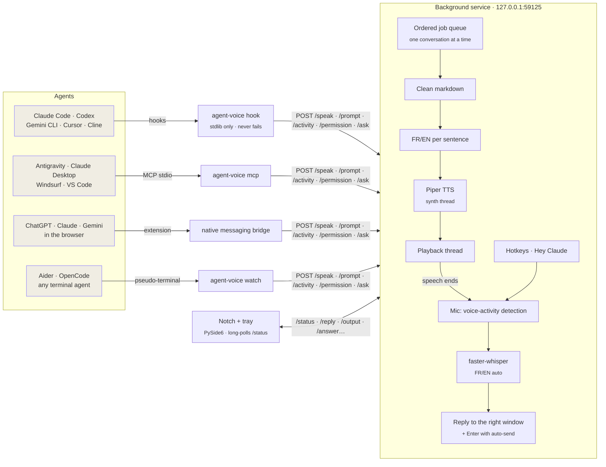

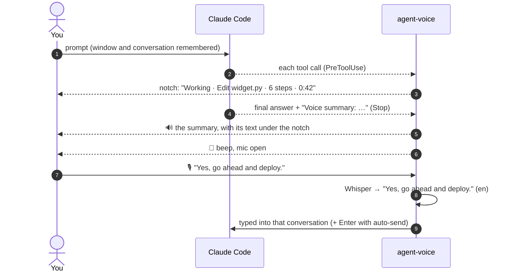

## ⚙️ Configuration

`~/.agent-voice/config.json` (created by `agent-voice setup`, merged over defaults):

| Key | Default | Meaning |
|---|---|---|
| `voices.en` / `voices.fr` | `en_US-hfc_male-medium` / `fr_FR-siwis-medium` | Any [Piper voice](https://huggingface.co/rhasspy/piper-voices); `name:speaker` for multi-speaker models. Downloaded on first use |
| `speed` | `0.67` | Piper length scale: `1.0` normal, lower is faster (the panel's speed overrides it) |
| `max_chars` | `1500` | Long replies are cut at a sentence boundary |
| `speak_progress` | `true` | Also speak Claude's messages between tool calls |
| `summary` | `enabled: true`, `max_chars: 280` | One-sentence summaries of final answers (runtime toggle in the panel) |
| `read_along` | `true` | Show the text being spoken under the notch |
| `thread_voices` | `true` | Each conversation speaks slightly lower or higher than the others |
| `auto_chime_in_calls` | `true` | Chimes instead of the voice while another app uses the microphone |
| `catch_up` | `enabled: true`, `away_minutes: 5` | *While you were away*: what finished and who needs you, when you come back |
| `desktop_apps` | `enabled: false`, `apps: {chatgpt, copilot, perplexity}` | Read these apps' notifications (also `agent-voice apps on`) |
| `auto_listen` | `enabled`, 15 s window, 1.5 s silence, 600 s max | Mic after the final answer |
| `permissions` | `enabled: true`, `wait_seconds: 60` | Approvals by voice / notch, and how long Claude waits before its own dialog |
| `wake_word` | `phrases: [hey claude, ok claude, …]` | Phrases accepted when Whisper confirms a keyword-spotter hit |
| `background_send` | `true` | Claude desktop app: send replies without bringing the window forward |
| `update_check` | `true` | Look for a newer release on GitHub at start |
| `chime.volume` | `0.35` | Chime loudness (0 to 1) |
| `stt.model` | `small` | Whisper size: `base` is faster, `small` is better in French |
| `widget.enabled` | `true` | Start the notch and tray icon with the service |
| `hotkeys.*` | see above | Any [keyboard](https://github.com/boppreh/keyboard) combination |

Restart after editing: `agent-voice shutdown && agent-voice start`.

## 🧰 Commands

```text
agent-voice start | shutdown | status          run / stop / inspect the background service
agent-voice say "text" [--lang fr|en] [--voice NAME]
agent-voice stop | mute [on|off|toggle] | unmute | handsfree [on|off|toggle] | summary [on|off|toggle] | speed [1-2]
agent-voice chime [on|off|toggle]               chimes instead of the voice
agent-voice wake [on|off|toggle]                "Hey Claude, ..." sends a new prompt while idle
agent-voice widget                              reopen the notch + tray icon
agent-voice install | uninstall [claude codex gemini cursor cline antigravity claude-desktop windsurf vscode browser | all]
agent-voice mcp [--client NAME]                 the MCP server (MCP apps start it themselves)
agent-voice watch <command>                     run a terminal agent with a voice
agent-voice new "prompt" [--agent A] [--cwd D]  start a new thread (Claude app, or a CLI agent in a new tab)
agent-voice apps [on|off|toggle]                read ChatGPT / Copilot / Perplexity desktop notifications
agent-voice usage on|off                        Claude Code's rate limits in the notch (adds a status line)
agent-voice autostart on|off                    start with Windows (a LaunchAgent on macOS)
agent-voice setup                               config, voices, Whisper model
agent-voice serve                               run in the foreground (debugging)
```

## 🔒 Privacy, security, battery

- **Offline by design**: text-to-speech, transcription, language detection and the wake word run locally. Audio never leaves the machine. The only network calls are the model downloads on first use and the optional release check.
- **Calls**: detected from Windows' own privacy records of which app uses the mic; no audio is touched.
- **Local API only**: the service listens on `127.0.0.1` and rejects any request carrying an `Origin` header, a foreign `Host` (DNS rebinding) or a non-JSON body. Web pages can't drive it. The browser extension goes through a native messaging bridge that only its own id can start.
- **Desktop apps' notifications** (off by default): only the listed apps' notifications are read, by a query that filters them, from Windows' local notification database; nothing else is opened.
- **Agent-safe**: hooks are stdlib-only, time-boxed and swallow their own errors. A voice problem never breaks your agent.
- **Battery first**: ONNX Runtime never busy-waits; the wake word runs a volume gate before its tiny model; at rest the notch doesn't redraw and asks for status only when something changes.

## 🧪 Development

```bash
.venv/Scripts/pip install -e ".[dev]"
.venv/Scripts/python -m pytest -q             # unit tests (the daemon runs without audio or threads)
.venv/Scripts/agent-voice serve               # service in the foreground, logs in the console
.venv/Scripts/python scripts/render_docs.py   # regenerate these images and the GIF from the widget code
```

Architecture notes, invariants and gotchas for contributors (human or AI) are in **[AGENTS.md](AGENTS.md)**.

## 🙏 Built with

| Project | Role | License |
|---|---|---|
| [Piper](https://github.com/OHF-Voice/piper1-gpl) (`piper-tts`) | Neural text-to-speech | GPL-3.0-or-later |
| [Piper voices](https://huggingface.co/rhasspy/piper-voices) | Voice models (`hfc_male`, `siwis`…) | Per voice: see each model card |
| [faster-whisper](https://github.com/SYSTRAN/faster-whisper) | Speech-to-text | MIT |
| [CTranslate2](https://github.com/OpenNMT/CTranslate2) | Whisper inference engine | MIT |
| [OpenAI Whisper](https://github.com/openai/whisper) | Speech recognition model weights | MIT |
| [ONNX Runtime](https://github.com/microsoft/onnxruntime) | Runs the Piper models | MIT |
| [Lingua](https://github.com/pemistahl/lingua-py) | French/English detection | Apache-2.0 |
| [PySide6 / Qt](https://doc.qt.io/qtforpython-6/) | Notch, widget and tray icon | LGPL-3.0 |
| [sounddevice](https://github.com/spatialaudio/python-sounddevice) | Audio playback & recording | MIT |
| [keyboard](https://github.com/boppreh/keyboard) | Global hotkeys | MIT |
| [pyperclip](https://github.com/asweigart/pyperclip) | Clipboard | BSD-3-Clause |
| [sherpa-onnx](https://github.com/k2-fsa/sherpa-onnx) | "Hey Claude" keyword spotting (model downloaded on first use) | Apache-2.0 |
| [py3langid](https://github.com/adbar/py3langid) | Language detection in the Windows release (lingua is too large to bundle) | BSD-3-Clause |
| [pyte](https://github.com/selectel/pyte) | Terminal emulator for `agent-voice watch` | LGPL-3.0 |
| [pywinpty](https://github.com/andfoy/pywinpty) | Pseudo-terminal on Windows (ConPTY) | MIT |
| [pynput](https://github.com/moses-palmer/pynput) | Global hotkeys on macOS | LGPL-3.0 |
| [comtypes](https://github.com/enthought/comtypes) | UI Automation: open the right conversation in the Claude desktop app | MIT |
| [NumPy](https://numpy.org) | Audio buffers | BSD-3-Clause |
| [Segoe Fluent Icons](https://learn.microsoft.com/windows/apps/design/style/segoe-fluent-icons-font) | Icons (system font, not redistributed) | Microsoft |

## 📄 License

Copyright © 2026 ElMastho.

agent-voice is free software: you can redistribute it and/or modify it under the terms of the **GNU General Public License v3.0 or later**. See [LICENSE](LICENSE). It is distributed in the hope that it will be useful, but **without any warranty**. GPL-3.0 is used because agent-voice builds on Piper, which is itself GPL-3.0. Voice models keep their own licenses.
