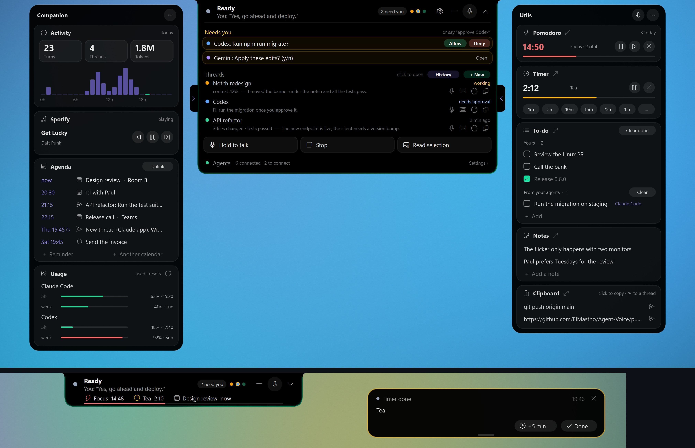
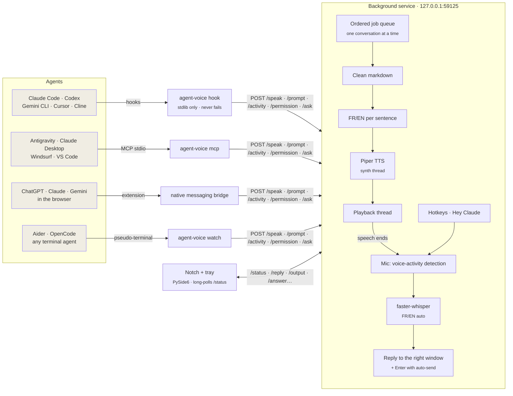
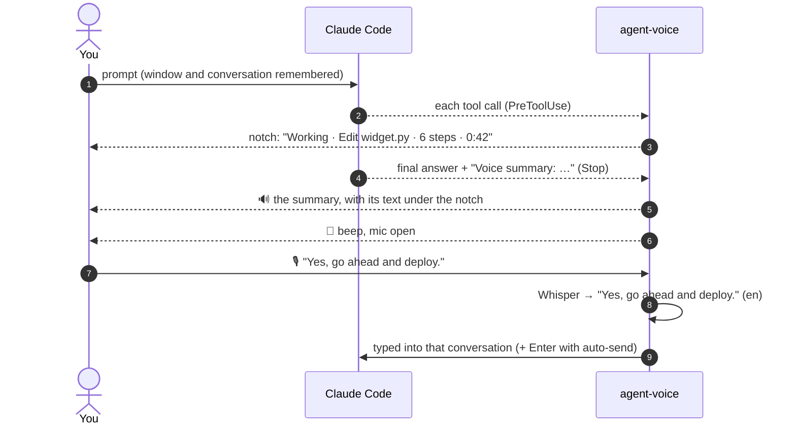

<p align="center">
  
</p>

<p align="center">
  <b>Hear your AI agents. Answer them by voice. Follow every one of them from a notch at the top of your screen.<br>Claude Code, Codex, Gemini, Cursor, Antigravity, ChatGPT in the browser... French or English, 100% on your machine.</b>
</p>

<p align="center">
  
  
  
  
  
</p>

<p align="center">
  <a href="#-quick-start">Quick start</a> ·
  <a href="#-the-notch">The notch</a> ·
  <a href="#-talking-to-your-agents">Talking to your agents</a> ·
  <a href="docs/guide.md">User guide</a> ·
  <a href="#-how-it-works">How it works</a> ·
  <a href="AGENTS.md">AGENTS.md</a>
</p>

---

**agent-voice** gives your AI agents a voice and ears, and puts all of them in one place: a black notch at the top of your screen. When Claude Code, Codex, Gemini CLI, Cursor, Cline, Antigravity, Claude Desktop, VS Code, ChatGPT or Claude in the browser, or any terminal agent answers, you **hear** it in a natural French or English voice and **read along** under the notch. While they work, a dot per conversation shows who's busy and who **needs you**; approve or answer from the notch, by voice or with a click. When an answer ends, the mic opens: **just talk**, and your reply goes back to the right conversation. Or send a message to any of them by name: *"Hey Claude, tell Codex to run the tests."*

Everything runs **locally on the CPU**: no cloud, no API key, no audio leaving your laptop. It's built to sip battery: nothing redraws or polls while nothing happens.

<p align="center">
  
  <br><sub>One turn: the agent works → reads its answer → the mic opens → you reply → the notch tucks itself away.</sub>
</p>

## ✨ Highlights

| | |
|---|---|
| 🏝️ **Every agent, one notch** | Hooks (Claude Code, Codex, Gemini CLI, Cursor, Cline), an **MCP server** (Antigravity, Claude Desktop, Windsurf, VS Code...), a **browser extension** (ChatGPT, Claude, Gemini, AI Studio, Perplexity, Copilot), **`agent-voice watch`** for any terminal agent, and desktop apps' notifications. |
| 🙋 **Needs you** | Approvals, questions and agents waiting for input, from every agent, in one list: *Allow* / *Deny* with a click, or say *"approve Codex"*. |
| 🔵 **A dot per conversation** | Who's working, who waits on you, who just finished, at a glance; click a dot to jump to it. |
| 🗂️ **While you were away** | Back at your desk (or out of a call): *"Notch redesign finished; Codex needs you."* |
| ⏳ **Resumes after a limit** | A thread runs out of quota while you're away: once the limit resets, the notch sends it *"Continue."* so it picks up where it stopped. On by default. |
| 🎯 **Focus** | In a call, presenting, or with an app full screen, replies are held (approvals still come through) and a catch-up follows. |
| 🌇 **Daily recap** | At 18:00 (or *"Hey Claude, daily recap"*): what each thread did today, what's still waiting, your limits and tokens. |
| 🗣️ **A natural voice** (opt-in) | *Voice: Natural* in Settings switches to [Kokoro](https://huggingface.co/hexgrad/Kokoro-82M): expressive, close to a cloud voice, still offline. *Light* (Piper) stays the default, easier on the battery. |
| 🧰 **Utils** (right) | The arrow on the open panel's right edge: a **Pomodoro** that holds agents' replies while you focus, **timers**, a **stopwatch**, your **to-do list** (agents add what only you can do), **notes** and your **clipboard**. *"Hey Claude, start a pomodoro"*, *"timer 10 minutes"*, *"remind me at 4 pm to call Paul"*, *"note: ..."*. |
| 🎵 **Companion** (left) | The arrow on its left edge: today's **activity**, **what's playing** (Spotify, YouTube Music, YouTube) with its controls, your **agenda** (today's meetings from your calendar's iCal link or Outlook, your reminders and the prompts you scheduled, in one list) and your agents' **usage**. A meeting about to start shows on the notch. |
| 🔎 **History** | Every prompt and every reply, from every agent, searchable in one box: "which one fixed the login bug last week?" Kept on this PC (90 days). |
| ⏳ **Take it back** | What you dictate waits 5 seconds under the notch before it's sent: say *"wait"* to fix it, *"cancel that"* to drop it, or keep talking to add to it. |
| 👀 **"Look at this"** | *"Hey Claude, look at this and tell me why it's red"*: a picture of the window you're looking at goes to your thread, with your question. |
| 🎧 **Headphones only** (opt-in) | The voice in your headphones; through the laptop's speakers (an open office), chimes and the banner instead. It switches by itself as you plug them in. |
| 📎 **Hand things over** | *"Hey Claude, send this to Codex and ask it to explain it"*: your selection, or the screenshot on the clipboard, goes to that thread. |
| 🔉 **Your video turns down** | While the voice speaks, other apps (YouTube, Spotify...) fade to 30% and come back after; while you reply, they go silent and a playing video pauses, then plays on. |
| 📱 **On your phone** (opt-in) | Turn on *Phone* in Settings, scan the QR code with the [ntfy](https://ntfy.sh) app: replies, approvals, limits and the recap reach your phone while you're away. |
| ⏰ **Scheduled prompts** | *"Hey Claude, at 2 pm tell Codex to run the tests"*, a time in the reply box, or `agent-voice schedule`: sent to a thread, or as a new thread, at that time (daily or weekdays if you like). |
| ⚡ **Saved prompts** | *"Hey Claude, run the tests"*, *"tell Codex to commit this"*: a name you say, a full prompt sent (`shortcuts`). |
| ➕ **Start a new thread** | `Ctrl+Alt+N`, *+ New* in the panel, or *"Hey Claude, new thread: add a health check"*: a new Claude Code session in the desktop app, or Claude Code / Codex / Gemini CLI in a new terminal tab. |
| 📣 **Talk to any thread by name** | *"Tell Codex to run the tests"* is typed into Codex's window and sent, wherever you are. |
| 📊 **Today, at a glance** | Open, the notch shows what needs you and your threads: *Done · 3 files changed · tests passed*, each conversation's context. Rest on a thread to read its last reply in full. In the Companion: today's turns, threads and tokens by hour, and Claude Code's and Codex's 5-hour and weekly **limits** (a heads-up at 90%). |
| 📎 **Drop files on the notch** | Screenshots, logs, files: dropped on the notch, they land in the conversation's prompt. |
| 🗣️ **Speaks every reply** | Final answers and the progress notes between tool calls, never twice. Markdown, code and paths are cleaned out so it sounds natural. |
| 📖 **Read along** | The text being spoken hangs under the notch, from the sentence you're hearing, and leaves 5 seconds after the voice stops. |
| ⏱️ **Live activity** | While an agent works: *Working · Edit widget.py · 14 steps* and a timer, like a Dynamic Island. |
| 📝 **Summaries, not essays** | Long answers become one sentence (Claude Code is asked for a `Voice summary:` line). Full answers are one click away. |
| 🎙️ **Answer by voice** | After the answer, a soft tone and the mic opens. Talk, pause, done: Whisper transcribes and your reply is typed (and sent, with auto-send) into the conversation it answers. |
| 🧵 **Several conversations** | Each one has its colour, its own voice pitch and its own window; a second one waits its turn and is announced by name. |
| 🔔 **Voice, Chimes or Do not disturb** | In the office: a soft chime and the reply as a banner. In a meeting: Do not disturb, nothing at all, and one click on the notch brings you back. In a call or full screen: replies are held for a catch-up afterwards. |
| ✅ **Approvals & questions** | Claude's permission prompts and multiple-choice questions, read out and shown in the notch: say *"yes"* or *"the second one"*, or click. |
| 👋 **"Hey Claude"** | Optional wake word: *"Hey Claude, run the tests"* sends a new prompt, hands-free. |
| 🇫🇷 🇬🇧 **Bilingual** | Each sentence is read by the matching voice; Whisper detects which language you speak. |
| 🔒 **Private, light, safe** | 100% offline; a local API that web pages can't reach; hooks that never break your agent. |

## 🚀 Quick start

### Download (Windows, no Python needed)

1. Get **`agent-voice-windows-x64.zip`** from the [latest release](https://github.com/ElMastho/agent-voice/releases/latest) and extract it anywhere (e.g. `C:\Tools\agent-voice`).
2. Double-click **`agent-voice.exe`**. The first run downloads the voices and the speech-recognition model (~600 MB), connects the agents it finds and starts the notch.
3. Optional: `agent-voice.exe autostart on` (or tray icon → *Start with Windows*).
4. Optional: ChatGPT, Claude or Gemini in the browser: `agent-voice.exe install browser`, then load the extension (see [the browser](#in-the-browser)).

Hooks point at the folder you extracted to: if you move it, double-click `agent-voice.exe` again. You can also connect an agent later from the notch: expand it and click the agent in the **Agents** row.

New versions install themselves in one click: see [Updating](#updating).

### From source

> Windows 11 · Python 3.13 recommended (some audio/ML wheels lag behind the newest Python).
> **macOS (beta)**: the same steps with `python3.13 -m venv .venv` and `.venv/bin/...`. Give your terminal the *Accessibility* permission (global shortcuts, typing your replies). The test suite runs on macOS in CI; the app itself is less tried there than on Windows.

> **Linux (beta)**: the same steps with `python3 -m venv .venv` and `.venv/bin/...`, plus a few system tools: `sudo apt install libportaudio2 pulseaudio-utils xdotool xclip xprintidle playerctl imagemagick` (Fedora: `portaudio pulseaudio-utils xdotool xclip xprintidle playerctl ImageMagick`). Sound goes through PulseAudio or PipeWire (`pactl`): other apps turn down under the voice, players pause while you reply (MPRIS), calls and headphones are detected. Windows are found and typed into with `xdotool`, so an **X11** session works best; under **Wayland** the notch runs through XWayland and replies reach apps that do too (the others get it on the clipboard). `agent-voice shortcut on` adds it to your app menu, `agent-voice autostart on` starts it at login. Not on Linux: the Claude desktop app's background send (there's no Linux app), and the one-click update (update with `git pull`). The test suite, and a smoke test against a real PulseAudio server and the notch on an X display, run on Linux in CI.

```bash
git clone https://github.com/ElMastho/agent-voice.git
cd agent-voice
py -3.13 -m venv .venv
.venv/Scripts/pip install -e .
.venv/Scripts/agent-voice setup              # config + voices + speech-recognition model (~600 MB)
.venv/Scripts/agent-voice install claude     # or: codex gemini cursor cline antigravity claude-desktop windsurf vscode browser | all
.venv/Scripts/agent-voice autostart on       # start with Windows (service + notch + tray icon)
.venv/Scripts/agent-voice start
```

Then open a **new** Claude Code session and ask it anything. You'll see it work in the notch, hear the answer, then a soft tone: reply out loud. The full walkthrough is in the **[user guide](docs/guide.md)**.

### Like any app
agent-voice adds itself to the **Start menu** the first time it runs: search for *agent-voice* to open it (it starts the service if it isn't running, and opens the notch's panel). From the tray icon: **Restart agent-voice** (the service and the notch come back together, with any new code), **Quit agent-voice** (everything stops), and *Start with Windows*. In a terminal: `agent-voice restart`.

### Updating

agent-voice looks for a new release on GitHub a few seconds after it starts, then once a day (`update_check: false` turns this off). When there is one, the notch shows an **Update** chip and the tray menu an *Update to vX* item.

- **Windows download**: click either one. agent-voice downloads `agent-voice-windows-x64.zip`, checks it (the release's exact asset, its size and checksum, every file in the zip), then stops, replaces the files in its folder and starts again; the notch says how it went. Your settings, voices and models in `~/.agent-voice` stay as they are, and your agents stay connected (same folder). If the download fails nothing is changed; if a file can't be replaced, the old version is put back. The log is `~/.agent-voice/logs/update.log`.
- **From source**: the chip only reminds you how, since your checkout is yours to update:

  ```bash
  git pull
  .venv/Scripts/pip install -e .
  .venv/Scripts/agent-voice shutdown && .venv/Scripts/agent-voice start
  ```

- **By hand** (any build): `agent-voice.exe shutdown`, tray → *Quit widget*, extract the new zip over the folder, and double-click `agent-voice.exe`.

## 🏝️ The notch

agent-voice lives in a pure-black island at the top centre of your screen. At rest it tucks itself away, leaving a 3-pixel line: touch the top edge with the mouse to bring it down. It drops down on its own when something happens, and goes back up 3 seconds after. Covering something while an agent works? The **—** button tucks it away until there's news (a voice, a question, something that needs you, a new reply).

<p align="center">
  
</p>

| State | What you see | Main button |
|---|---|---|
| **Ready** | A slate dot and what you said last | 🎙️ talk now |
| **Working** | Three dots ticking in the conversation's colour, the current step, a timer, *+1 working* for the others | 🎙️ talk now |
| **Speaking** | Bars following the voice, a violet light running around the edge, the language | ⏭️ skip & answer |
| **Hearing you** | Bars following your voice level, a green edge light; *Auto* when replies are sent for you | ⏹️ cancel |
| **Transcribing** | A spinning amber arc; *+1 waiting* when another conversation is next | — |
| **In a call** / **Chime** / **Speakers** / **Do not disturb** | A chip saying which mode you're in | 🎙️ talk now (🔔 back from Do not disturb) |

The edge light only shows while the voice or the mic is live: it doubles as a "mic on" signal.

### Every agent at a glance

<p align="center">
  
</p>

- **A dot per live conversation**, in its colour, on the right of the notch: filled while it works or talks, ringed in amber while it waits on you, dimmed once it's done. Hover for its name and state, click to open it.
- **N need you**: approvals, questions and agents waiting for input, from every agent. The panel lists them with *Allow* / *Deny* (or *Open* for those you answer in their own window), and you can answer by voice: *"approve Codex"*, *"deny the notch one"*, *"yes"*, and with several waiting (numbered), *"approve all"*, *"deny two"*.
- **Out of quota**: a thread that hits its 5-hour or weekly limit shows *Out of quota · resumes 15:20* in the list. A minute after the reset, the notch sends it *"Continue."* (`resume.message`), even if you're not there; click *✓ Resume* to cancel. With `resume.auto` off, it asks first: click *Resume* or say *"resume when it resets"*. It learns about the limit from Claude Code's `StopFailure` hook, from the limit message itself (*"5-hour limit reached ∙ resets 3pm"*) and from a full window in **Limits**; without a reset time it tries again every 30 minutes.
- **What the turn changed**: when a conversation finishes, *Done · 3 files changed · tests passed* (from the files it edited and its last test run); click it to open the conversation.
- **Context**: *Context 86%* when the conversation at work is running out of context; each thread shows its own.
- **While you were away**: after 5 minutes without touching the keyboard or mouse, or at the end of a call, a violet banner (spoken in Voice mode) tells you what finished and who needs you.
- **Focus**: in a call, while presenting, or with an app full screen (Windows' own "do not disturb" signals), replies are held: no voice, no banner, no chime. Approvals and questions still come through. When it ends, the catch-up tells you what finished. The notch shows *Focus* (or *In a call*); picking Voice in Settings overrides it until it ends. `focus.calls: "chimes"` keeps the old chimes during calls.
- **The open notch** takes a third of the screen, up to 600 px (480 px when closed): what needs you, your threads, and a line for your agents. ⚙ turns it into **Settings**. Your day (agenda, usage, activity) is in the Companion on its left, your tools in Utils on its right.
- **Reply previews**: rest the mouse on a thread for half a second and its last reply opens beside the panel, in full and formatted (code, lists, tables), with what it changed and its tokens today. It scrolls with the wheel and never takes the focus.
- **Headphones only** (Windows, opt-in): choose *Headphones only* in Settings (or the tray) and the voice plays only when the sound goes to headphones or a headset. Through speakers or a monitor, you get chimes and the reply as a banner, and the notch says *Speakers*; plug your headphones in and the voice is back. Picking *Voice* while on speakers keeps the voice until the device changes.
- **Other apps' sound** (Windows): while the voice speaks, every other app's volume fades to 30% of where it was (`ducking.voice`), and back once it's done; while you reply (the mic is open), they go silent (`ducking.listen`) and a video or song that's playing is paused with the media key, then played again, so you can answer without shouting over YouTube. Only what agent-voice paused is resumed, and a volume you change yourself meanwhile is left alone. `ducking.enabled: false` turns it off.
- **Phone notifications** (off until you turn them on): *Phone* in Settings turns them on and shows a QR code: in the [ntfy](https://ntfy.sh) app (iPhone, Android, or the web) tap **+** and scan it or paste the link (click it to copy). Fold the card to one line once you're set. You get what needs you, finished replies (their one-line summary), limits and resumes, scheduled prompts and the daily recap, by default only while you're away from the PC (2 minutes idle, in focus, or away). A burst of events comes as one notification. *Test* sends one; *New link* makes a new private channel (the old QR code stops getting anything). See [Privacy](#-privacy-security-battery) for what this sends and where.
- **Scheduled prompts**: say *"Hey Claude, at 2 pm tell Codex to run the tests"*, *"in 20 minutes, new thread: add a health check"*, *"demain à 9h lance les tests"*; or type a time in the reply box's *When* field (*14:00*, *in 30 min*, *tomorrow 9am*); or `agent-voice schedule "prompt" --at 14:00 [--thread Codex | --new --agent codex] [--repeat daily|weekdays]`. They wait in the Companion's **Agenda** (× cancels one), survive restarts, and are sent in the thread's own window at that time (saved prompts expand). Missed by more than 6 hours because the PC was off: you're told, nothing is sent late.
- **Daily recap**: at 18:00 (`recap.at`), once, a violet *Today* banner: turns and tokens, what each thread did (from its last summary), what's still waiting on you, and your limits; spoken in Voice mode. Any time: *"Hey Claude, daily recap"*, *"what did I do today?"*, the tray's *Today's recap*, or `agent-voice recap`.
- **Drop files**: drag screenshots, logs or files onto the notch (or onto a thread in the panel): their paths are typed into that conversation's prompt, not sent, so you can add your question.

### Read along

<p align="center">
  
</p>

While a reply is read out, its text hangs under the notch, starting at the sentence you're hearing, and stays 5 seconds after the voice stops, so you can finish reading. Swipe it up to hide it for this reply; click it to open the conversation. (`read_along: false` turns it off.)

### What you said, before it goes

<p align="center">
  
</p>

Once your reply is transcribed, it drops down under the notch framed in green, the colour of your voice, so it's never mistaken for the agent's text: who it goes to, and whether it was **sent** (auto-send), **typed** into the prompt for you to check, taken as an **answer** to a question or approval, or as a **command**.

<p align="center">
  
</p>

**Take it back.** What you dictate and send waits 5 seconds under the notch first, with a countdown and *Send now*, *Edit* and *Cancel*. The mic stays open meanwhile: say *"wait"* (or *"attends"*) and it's typed into the conversation without being sent, to fix it there; *"cancel that"* drops it; *"send it"* sends it now; anything else you say is added to the message and the countdown starts again. Scheduled prompts and replies you type aren't held. `take_back.seconds` sets the wait (0: off).

### Utils and the Companion: either side of the panel

<p align="center">
  
</p>

Two small arrows on the open panel's edges open a panel on each side. **⋯** picks which cards each shows.

**The Companion**, on the left, your day:

- **Activity**: today's turns, threads and tokens, and the turns by hour.
- **Now playing**: Spotify, YouTube Music, or YouTube (and other sites) in a browser: the song, the artist, ⏮ ⏯ ⏭. Read from what the players report to Windows (the volume flyout's player), else their window titles; the buttons are the keyboard's media keys. Or say *"pause the music"*, *"next song"*.
- **Agenda**: what's coming, in time order: your meetings (*now* highlighted), your reminders (*+ Reminder*: *16:00 call Paul*, *in 20 minutes stretch*, *tomorrow at 9 send the invoice*) and the prompts scheduled for your threads; × takes a reminder or a prompt off. Paste your calendar's **iCal link** (Outlook: *Settings › Calendar › Shared calendars › Publish a calendar*, the ICS link; Google: *Settings › your calendar › Secret address in iCal format*), or a `.ics` file; Outlook (classic) is read while it's open. A meeting in the next 15 minutes shows on the notch (*Design review · in 10 min*). `calendar.quiet_in_meetings` holds replies during meetings, as in a call.
- **Usage**: Claude Code's and Codex's 5-hour and weekly limits, and when they reset (more below).

**Utils**, on the right, the tools:

- **Pomodoro**: 25 minutes of focus, a 5-minute break, a 15-minute one after every 4th; pause, skip, stop, and how many today (`pomodoro` in the config sets the lengths). **While you focus, agents' replies wait** (approvals still come through) and the break starts with a catch-up of what happened (`pomodoro.hold`).
- **Timer**: one click on *1m*, *5m*, *10m*... (or **…** for *"12 min tea"*), several at once, paused and resumed.
- **Stopwatch**: start, pause, reset.
- **To-do**: tick, add, remove, *Clear done*; yours and your agents' apart, grouped by category (*call Paul #work*, or right-click an item). ⤢ on any Utils card opens it large, over the panel. *Clear* on *From your agents* empties their part. Your agents use it too: when a reply ends with *"To-do for you: run the migration on staging"* (Claude Code is asked to, rarely: only for a step the work is waiting on, two per thread and eight in all at most), it lands on your list, tagged with the agent; click it to open that conversation. Claude Code (through its own MCP server, added by `agent-voice install claude`) and every MCP app can also read the list, add to it and tick items off.
- **Notes**: one line, typed or said (*"note: the bug only happens with two monitors"*), kept and searchable in History.
- **Clipboard**: the last things you copied (in memory only, never written; password managers' copies are left out): click one to copy it again, ➤ to put it in the current thread's message box.

Or say it: Utils' 🎤, or *"Hey Claude, ..."*: *"start a pomodoro"*, *"skip the break"*, *"timer 10 minutes for the tea"*, *"start the stopwatch"*, *"add call the bank to my list"*, *"remind me at 4 pm to call Paul"*, *"minuteur 5 minutes"*, *"rappelle-moi dans 10 minutes de sortir le linge"*. Into Utils' mic, anything else joins the to-do list.

While the Pomodoro, a timer or the stopwatch runs, the notch stays down with a **second line**: each clock and the timer's progress and a meeting about to start (click it to open Utils). When a timer ends or a reminder is due: a banner with *+5 min* and *Done*, a chime and the voice (*"Time's up: the tea."*); just the chime in Chimes, the banner alone in Do not disturb. Each Pomodoro phase ends the same way (*"Time for a break: 5 min."*, *"Back to focus."*), and the next one starts by itself. Everything is kept by the service, through restarts; a timer that ran out while the PC slept is still told.

### Chimes: the reply as a banner

<p align="center">
  
</p>

**Do not disturb** (`Ctrl+Alt+M`) is for a meeting: no voice, no sound, no banner, and the notch stays tucked at the top even while agents work; hover it to look. What happens meanwhile is kept (approvals and questions wait in *Needs you*; phone notifications, if on, still reach you). One button on the notch, where the mic usually is, turns it off and puts you back in Voice or Chimes, as you were, with a *While you were away* catch-up.

In **Chimes** (a soft sound), nothing talks, not even a setting change. Each finished reply drops down as a banner for about 10 seconds (longer for long replies): hover to keep it, swipe it up to dismiss it, click it to open the conversation. **Reply** opens a box under the notch to type your answer (Enter sends it to that conversation, wherever its window is); **Talk** opens the mic for it. Both are on the read-along banner too. While **another app holds the mic** (Teams, Zoom, Meet...), presenting or full screen, agent-voice holds replies (approvals still come through) and catches you up afterwards ([Focus](#every-agent-at-a-glance)); `focus.calls: "chimes"` gives chimes in calls instead, and picking *Voice* overrides it until it ends. Every sound is a soft tone on a stream of its own, so a cue never cuts the voice off.

### Every action, one click away

<p align="center">
  
</p>

Open the chevron. Each thing has one place: what needs you and your threads here, how it behaves in Settings, your day in the Companion, your tools in Utils.

- **Needs you** (when something waits on you): approve, deny or open, for every agent.
- **Threads**: your recent conversations, what each is doing (*working*, *speaking*, *asks you*, *needs approval*, *waiting for you*, *next up*), what its last turn changed, its context, and the start of its last reply. Its buttons: 🎙️ **talk to it** (what you say is sent to that conversation), ⌨️ **type to it**, replay and copy. Click the row to open it. *History* searches every conversation; *+ New* starts one.
- **Hold to talk**, **Stop** and **Read selection** (the actions that aren't about one thread), with their shortcuts in their tooltips. *Read selection* hides itself in Chimes and Do not disturb.
- **Agents**: how many are connected; click it for the list, in Settings.
- **⚙ Settings** (in the notch's row): **Language** (English or Français: the one you speak and hear most; when detection is unsure, the voice reads in it and what you say is taken in it), **Speech** (*Voice*: Light or Natural, *Speed* 1× to 2×, *Replies*: a summary or in full), **When it speaks** (*Mode*: Voice / Chimes / Do not disturb, *Speakers*: too, or headphones only), **Listening** (*Hey Claude*, *Auto-send*, *Approvals*: click only, or by voice too), **Phone** (on, with its QR code), **Look** (dark or light) and **Agents**: which are connected (green dot): Claude Code, Codex, Gemini CLI, Cursor, Cline, Antigravity, the Claude desktop app, Windsurf, VS Code and the browser. Click one that isn't to connect it, or **?** for the setup guide. *Done* goes back to your threads.

The Companion's **Usage** card shows how much of each agent's **5-hour** and **weekly** limits is used, and when each resets, with a note once a window passes 90%.
  - **Claude** (Claude Code in a terminal or in the desktop app): every 10 minutes while you use Claude, agent-voice runs Claude Code's own `claude -p /usage`. That's a local command (no model request, your credentials stay inside Claude Code) and gives the same numbers as Claude's Usage page. In between, the bars move with your requests, estimated from your local transcripts (marked *≈*). A terminal session's status line (`agent-voice usage on`) reports them too.
  - **Codex**: read from its own session logs, nothing to set up.
  - **Anything else**: any agent or script can drop its numbers in `~/.agent-voice/usage/<agent>.json` (`{"five_hour": {"pct": 42, "resets": <epoch>}, "seven_day": {...}}`); they show up within a minute.
  - Gemini CLI and Antigravity don't expose theirs, so they aren't shown.
  - **↻** on the card refreshes them all now.

The notch **never takes keyboard focus**, so your dictated reply still lands in the right window. It stays above your other windows.

<br clear="right">

### Prefer it floating?

<p align="center">
  
</p>

Right-click the notch → *Float the widget again*: the same black island, rounded all round, that you drag anywhere (it snaps to edges and remembers its place), with the same edge light, read-along, banners and panel. *Compact* shrinks it to a black orb with the same state mark; a click on it talks, cancels or skips. `Ctrl+Alt+W` or a click on the tray icon shows / hides it.

## 💬 Talking to your agents

- **Reply**: after each answer the mic opens for 15 s (`Ctrl+Alt+A` to skip the voice and answer right away). Your reply goes to the window and the conversation it answers, even if it's minimized or another app is in front; once sent, you're returned to where you were. In the **Claude desktop app**, with auto-send on, it's sent **without bringing the app forward**. The text also stays on the clipboard.
- **History** ([picture](docs/images/history.jpg)): *History* in the panel's Threads header (or the tray's *Search history…*) opens a search box under the notch. Type a few words (*"login bug"*, *"migration codex"*): the best matches across every agent and thread, what you asked and what they answered, and the whole entry beside it, with *Copy* and *Open the thread*. Arrow keys move through the list, Enter opens the thread. Claude Code, Cline, Codex, Gemini CLI and Cursor replies are kept in full (not just their spoken summary), and your Claude Code and Cline prompts too. In a terminal: `agent-voice history login bug`.
- **Talk over it** (in headphones): you don't have to wait for the voice to finish. Start talking and it stops at once; *"stop"* or *"no, wait"* (*"attends"*, *"arrête"*) opens the mic for what you want to say instead, and a whole sentence is taken as your reply. Through speakers it stays off (the mic would hear the voice itself) unless you set `barge_in.speakers: true`.
- **Auto-send** (`Ctrl+Alt+H`): your spoken replies are submitted for you.
- **Push-to-talk** (hold `Ctrl+Alt+Space`): dictate into any app.
- **Voice commands** in the reply window: *"repeat that"*, *"slower"*, *"faster"*, *"never mind"* (or *"répète"*, *"plus lentement"*, *"plus vite"*, *"annule"*) drive agent-voice instead of being sent.
- **Approvals**: when Claude Code asks to run a command or edit a file, the request is read out and shown with *Allow once* / *Deny*. Say *"yes"* / *"no"* (*"oui"* / *"non"*) or click; with no answer within a minute, Claude shows its own dialog. Voice never grants more than once. Several agents can ask at once: the first is read out, the others wait in **Needs you**, and *"approve Codex"* answers the one you name.
- **New threads**: `Ctrl+Alt+N` (or *+ New* in the panel's Threads, or the tray) opens a box under the notch: pick where it runs (**Claude app**: a new Claude Code session in the desktop app, in your folder's group; or **Claude Code**, **Codex**, **Gemini CLI** in a new Windows Terminal tab), check the folder (the one you last worked in; **Folders** lists your recent ones and *Browse…* picks any other, and typing a path completes it), then type the first prompt or press **Talk** and say it. By voice: *"Hey Claude, new thread: add a health check"*, *"start a new conversation with Codex to …"*, *"nouvelle session : …"*. From a script: `agent-voice new "prompt" [--agent claude-app|claude|codex|gemini] [--cwd DIR]`.
- **Messages by name**: *"Hey Claude, tell Codex to run the tests"* (or *"dis à Codex de lancer les tests"*, or in the reply window *"tell the notch redesign to commit"*) types *"Run the tests"* into that conversation's own window, sends it, and brings you back.
- **Hand things over**: select text in any app (or copy a screenshot), then *"Hey Claude, send this to Codex"*: it lands in Codex's message box for you to add your question, or with *"... and ask it to explain it"* it's sent right away. Nothing selected or copied? A picture of the window you're looking at goes instead. Screenshots are saved to `~/.agent-voice/shots` (the last 20) and passed as a file path. French: *"envoie ça à Codex"*.
- **"Look at this"**: *"Hey Claude, look at this and tell me what's wrong"* takes a picture of the window in front (an error dialog, a broken page, a chart) and sends it to your current thread with your question; *"look at this"* alone puts it in the thread's message box for you to finish. Also *"check this error"*, *"regarde ça"*.
- **Saved prompts** (`shortcuts`): say a name and its full prompt is sent: *"Hey Claude, run the tests"* (the current thread), *"tell Codex to commit this"*, or just *"review this"* in the reply window, or typed in the reply box. Defaults: *run the tests*, *commit this*, *review this*, *explain that*, *lance les tests*, *fais un commit*; add your own in the config.
- **Questions**: when the agent asks you to choose (Claude Code's questions, Cline's follow-ups), the options appear in the notch and are read out. Click one or say it: *"the second one"*, *"option 3"*, or its name; anything else is sent as your own answer.
- **Several conversations**: when a second one finishes while another is talking (or waiting for you), it waits its turn and is announced by name. Each speaks a little lower or higher than the others (`thread_voices`), so you can tell them apart without looking.
- **Hey Claude** (off by default, switch it on in Settings): while idle, *"Hey Claude, run the tests"* is sent to your last conversation as a new prompt; *"Hey Claude"* alone opens the mic. A 3.3M-parameter keyword spotter ([sherpa-onnx](https://github.com/k2-fsa/sherpa-onnx)) listens only while someone speaks, so it costs next to nothing; short phrases it misses (an accent it doesn't know: "Klod") get a quick check by Whisper tiny, and Whisper confirms every phrase before anything is sent.
- **Read anything aloud**: select text in any app and press `Ctrl+Alt+R`.
- **Updates**: when a newer release is on GitHub, the notch shows an *Update* chip and the tray menu offers it; on the Windows download, one click installs it and restarts ([Updating](#updating)).

## ⌨️ Shortcuts

| Keys | Action |
|---|---|
| `Ctrl+Alt+A` | **Reply now**: stop the voice and listen for your answer |
| `Ctrl+Alt+Space` *(hold)* | **Push-to-talk** in any window |
| `Ctrl+Alt+S` | **Stop** speaking / listening |
| `Ctrl+Alt+H` | **Auto-send** on/off |
| `Ctrl+Alt+C` | **Chimes** on/off |
| `Ctrl+Alt+M` | **Do not disturb** on/off |
| `Ctrl+Alt+R` | **Read** the selected text aloud |
| `Ctrl+Alt+W` | **Show / hide** the notch |
| `Ctrl+Alt+N` | **New thread**: type or say its first prompt |

All of them can be changed in `~/.agent-voice/config.json`.

## 🤖 Supported agents

| Agent | How it connects | Install |
|---|---|---|
| **Claude Code** (CLI, desktop, IDE) | `Stop`, `PreToolUse`, `UserPromptSubmit`, `Notification` and `PermissionRequest` hooks: progress, live activity, final answer, questions, approvals, files changed and tests, context | `agent-voice install claude` |
| **Codex CLI** | `notify` in `~/.codex/config.toml`, plus the MCP server (live status, questions) | `agent-voice install codex` |
| **Gemini CLI** | `AfterAgent` and `Notification` hooks in `~/.gemini/settings.json`, plus the MCP server | `agent-voice install gemini` |
| **Cursor** | `afterAgentResponse` in `~/.cursor/hooks.json`, plus the MCP server in `~/.cursor/mcp.json` | `agent-voice install cursor` |
| **Cline** | Hook scripts in `~/Documents/Cline/Hooks` (`.ps1` on Windows): completions, follow-up questions with their options, plan replies | `agent-voice install cline`, then Cline settings → *Enable Hooks* |
| **Antigravity** | MCP server in its `mcp_config.json` | `agent-voice install antigravity` |
| **Claude Desktop** (chats) | MCP server in `claude_desktop_config.json` (the Microsoft Store version too) | `agent-voice install claude-desktop` |
| **Windsurf** · **VS Code** (Copilot agent mode) | MCP server in their MCP config | `agent-voice install windsurf` · `vscode` |
| **ChatGPT, Claude, Gemini, AI Studio, Perplexity, Copilot, Mistral, DeepSeek** in Chrome, Edge or Brave | Browser extension + a native messaging bridge | `agent-voice install browser`, then load the extension |
| **Aider, OpenCode, Goose, Copilot CLI**, any terminal agent | `agent-voice watch <command>` runs it in a pseudo-terminal and reads its screen | none |
| **ChatGPT, Copilot, Perplexity** desktop apps | Their Windows notifications (opt-in) | `agent-voice apps on` |
| Anything else | select + `Ctrl+Alt+R`, or `echo text \| agent-voice say` | none |

Or click the agent in the notch's **Agents** row. Installers back up the file they touch (`*.bak-agent-voice`), keep your other settings and servers, are idempotent, and `agent-voice uninstall <agent>` reverts them.

### The MCP server

`agent-voice mcp` speaks the [Model Context Protocol](https://modelcontextprotocol.io) over stdio, so any MCP app can use it. It gives the agent these tools, and tells it when to use them:

| Tool | What it does |
|---|---|
| `speak` | Says a short message out loud (or shows it under the notch when the voice is off). Agents are asked to call it once at the end of each reply, with a one-sentence summary. |
| `set_status` | *Working · Running the tests* in the notch, with a timer. |
| `ask_user` | Asks you a question, with options or free text, out loud and in the notch, and waits for your spoken or clicked answer. |
| `notify` | A banner without the voice; `needs_you` puts it in **Needs you**. |
| `todo_list`, `todo_add`, `todo_update` | Your to-do list in Utils: read it, add to it (in a category), tick items off, reword, refile or remove them. |

Apps that already speak through hooks (Codex, Gemini CLI, Cursor) get the server without `speak`, so nothing is read twice; Claude Code gets the to-do tools only (`--todo-only`: its hooks do the rest), added with its own `claude mcp add`. To add it by hand elsewhere: command `agent-voice` (or `agent-voice.exe`), arguments `mcp --client <name>`.

### In the browser

`agent-voice install browser` registers the bridge with Chrome, Edge, Brave and Chromium (no admin rights needed) and opens the extension's folder. In the browser, open `chrome://extensions` (or `edge://extensions`), turn on **Developer mode**, click **Load unpacked** and pick that folder. From then on, a reply on ChatGPT, Claude, Gemini, AI Studio, Perplexity, Copilot, Mistral or DeepSeek is read out (its summary, or in full), the notch shows the tab working, and your spoken reply is typed back into the page. Web pages still can't reach agent-voice: only this extension can start the bridge, and the bridge only accepts these sites.

### Terminal agents

```bash
agent-voice watch aider          # or: opencode, goose, gh copilot, any command
```

The agent runs exactly as before, in your terminal. agent-voice reads the screen it draws (through a terminal emulator, so full-screen interfaces work too): press Enter and the notch shows it working; when the screen goes quiet, the new text is its reply. A last line that asks something (*Apply these edits? (y/n)*) goes to **Needs you** instead.

## 🧠 How it works





## ⚙️ Configuration

`~/.agent-voice/config.json` (created by `agent-voice setup`, merged over defaults):

| Key | Default | Meaning |
|---|---|---|
| `voices.en` / `voices.fr` | `en_US-hfc_male-medium` / `fr_FR-siwis-medium` | Any [Piper voice](https://huggingface.co/rhasspy/piper-voices); `name:speaker` for multi-speaker models. Downloaded on first use |
| `engine` | `"piper"` | The voice: `"piper"` (light) or `"kokoro"` (natural; Settings' *Voice* row overrides it) |
| `kokoro.voices` | `en: af_heart`, `fr: ff_siwis` | Kokoro's voices per language (`af_*`/`am_*` American, `bf_*`/`bm_*` British, `ff_siwis` French) |
| `speed` | `0.67` | Piper length scale: `1.0` normal, lower is faster (the speed in Settings overrides it) |
| `max_chars` | `1500` | Long replies are cut at a sentence boundary |
| `speak_progress` | `true` | Also speak Claude's messages between tool calls |
| `summary` | `enabled: true`, `max_chars: 280` | One-sentence summaries of final answers (runtime switch in Settings: *Replies*) |
| `read_along` | `true` | Show the text being spoken under the notch |
| `thread_voices` | `true` | Each conversation speaks slightly lower or higher than the others |
| `auto_chime_in_calls` | `true` | Chimes instead of the voice while another app uses the microphone |
| `catch_up` | `enabled: true`, `away_minutes: 5` | *While you were away*: what finished and who needs you, when you come back |
| `resume` | `auto: true`, `message: "Continue."` | Out of quota: send this once the limit resets (`auto: false`: only when you ask) |
| `focus` | `enabled: true`, `full_screen: true`, `calls: "hold"` | Hold replies in calls, presentations and full screen apps (`calls: "chimes"`: chimes in calls) |
| `recap` | `enabled: true`, `at: "18:00"` | The daily recap's time |
| `shortcuts` | *run the tests*, *commit this*, … | Saved prompts: `{"name you say": "prompt sent"}` |
| `history` | `enabled: true`, `days: 90` | Every prompt and reply, searchable, in `~/.agent-voice/history.db` |
| `barge_in` | `enabled: true`, `speakers: false` | Talk over the voice to stop it (in headphones; through speakers only if `speakers`) |
| `take_back.seconds` | `5` | How long what you dictate waits under the notch before it's sent (0: at once) |
| `headphones.only` | `false` | The voice only in headphones; chimes and banners on speakers |
| `ducking` | `enabled: true`, `voice: 0.3`, `listen: 0.0`, `pause_media: true` | Other apps' volume under the voice and while you reply, and pausing what's playing |
| `limits.claude_refresh_minutes` | `10` | How often (while you use Claude) to run Claude Code's `claude -p /usage` for its limits; `0` turns it off |
| `ntfy` | `server: https://ntfy.sh`, `token: ""`, `content: "summary"`, `when: "away"`, `away_minutes: 2`, `events: [needs, done, limit, recap, scheduled]` | Phone notifications: your own server and token, `content: "titles"` (only the thread and what happened) or `"full"`, `when: "always"` |
| `desktop_apps` | `enabled: false`, `apps: {chatgpt, copilot, perplexity}` | Read these apps' notifications (also `agent-voice apps on`) |
| `auto_listen` | `enabled`, 15 s window, 1.5 s silence, 600 s max | Mic after the final answer |
| `permissions` | `enabled: true`, `wait_seconds: 60` | Approvals by voice / notch, and how long Claude waits before its own dialog |
| `wake_word` | `phrases: [hey claude, ok claude, …]` | Phrases accepted when Whisper confirms a keyword-spotter hit |
| `background_send` | `true` | Claude desktop app: send replies without bringing the window forward |
| `update_check` | `true` | Look for a newer release on GitHub at start, then daily (installing one is always your click) |
| `chime.volume` | `0.35` | Chime loudness (0 to 1) |
| `stt.model` | `small` | Whisper size: `base` is faster, `small` is better in French |
| `widget.enabled` | `true` | Start the notch and tray icon with the service |
| `hotkeys.*` | see above | Any [keyboard](https://github.com/boppreh/keyboard) combination |

Restart after editing: `agent-voice shutdown && agent-voice start`.

## 🧰 Commands

```text
agent-voice start | shutdown | restart | status   run / stop / restart / inspect the background service (and the notch)
agent-voice open                                show the notch's panel, starting agent-voice if needed (the Start menu entry)
agent-voice shortcut on|off                     agent-voice in the Windows Start menu
agent-voice say "text" [--lang fr|en] [--voice NAME]
agent-voice stop | mute [on|off|toggle] | unmute | handsfree [on|off|toggle] | summary [on|off|toggle] | speed [1-2]
agent-voice chime [on|off|toggle]               chimes instead of the voice
agent-voice wake [on|off|toggle]                "Hey Claude, ..." sends a new prompt while idle
agent-voice headphones [on|off|toggle]          the voice only in headphones (chimes on speakers)
agent-voice widget                              reopen the notch + tray icon
agent-voice install | uninstall [claude codex gemini cursor cline antigravity claude-desktop windsurf vscode browser | all]
agent-voice mcp [--client NAME]                 the MCP server (MCP apps start it themselves)
agent-voice watch <command>                     run a terminal agent with a voice
agent-voice new "prompt" [--agent A] [--cwd D]  start a new thread (Claude app, or a CLI agent in a new tab)
agent-voice apps [on|off|toggle]                read ChatGPT / Copilot / Perplexity desktop notifications
agent-voice usage on|off                        Claude Code's rate limits in the notch (adds a status line)
agent-voice recap                               today's recap: threads, what's waiting, limits, tokens
agent-voice history [words] [--clear]           search every conversation (what you asked, what they answered)
agent-voice schedule "prompt" --at WHEN [--thread NAME | --new [--agent A] [--cwd D]] [--repeat daily|weekdays]
agent-voice schedule --list | --cancel ID       what's scheduled
agent-voice phone on|off|test|new|status        phone notifications (ntfy)
agent-voice autostart on|off                    start at login (Windows; a LaunchAgent on macOS; XDG autostart on Linux)
agent-voice setup                               config, voices, Whisper model
agent-voice serve                               run in the foreground (debugging)
```

## 🔒 Privacy, security, battery

- **Offline by design**: text-to-speech, transcription, language detection and the wake word run locally. Audio never leaves the machine. agent-voice's own network calls are the model downloads on first use (the natural voice's too, from its GitHub release, checked against pinned SHA-256 sums), the optional release check, the new release's zip when you click *Update*, and, only if you turn them on, phone notifications.
- **Phone notifications (opt-in, off by default)**: when you turn on *Phone*, notifications go to the ntfy server (`ntfy.sh` unless you set your own) over HTTPS, then to your phone. What leaves is the thread's name, what happened and, by default, its one-line summary (`ntfy.content: "titles"` sends no reply text at all, `"full"` sends the reply). Your audio, prompts, files and transcripts never do. The channel is a long random topic: anyone who has it (the QR code, the link) can read your notifications, so keep it private, and *New link* revokes it. ntfy.sh topics are public by name and messages are kept on the server for a while ([ntfy's docs](https://docs.ntfy.sh/)); for full control, run your own ntfy server and set `ntfy.server` and an access `ntfy.token` (never written to logs). Nothing is sent while it's off, and phones can't send anything back.
- **Claude's limits**: agent-voice runs Claude Code's own `claude -p /usage` (a local command of the Claude Code you installed; it fetches your usage from Anthropic with your login, like the Usage page) and reads what it saves. agent-voice never reads Claude's credentials. Between readings it reads only the token counts in your local transcripts. `limits.claude_refresh_minutes: 0` turns this off.
- **History**: kept in a local SQLite file (`~/.agent-voice/history.db`), never sent anywhere, trimmed to `history.days` (90). `agent-voice history --clear` forgets it all, `history.enabled: false` stops keeping it.
- **"Look at this"**: the picture of your window is saved locally (`~/.agent-voice/shots`, the last 20) and handed to the agent you named, which reads it like any file you give it (and sends it to its model). It's only taken when you ask.
- **Calls**: detected from Windows' own privacy records of which app uses the mic; no audio is touched.
- **Local API only**: the service listens on `127.0.0.1` and rejects any request carrying an `Origin` header, a foreign `Host` (DNS rebinding) or a non-JSON body. Web pages can't drive it. The browser extension goes through a native messaging bridge that only its own id can start.
- **Desktop apps' notifications** (off by default): only the listed apps' notifications are read, by a query that filters them, from Windows' local notification database; nothing else is opened.
- **Agent-safe**: hooks are stdlib-only, time-boxed and swallow their own errors. A voice problem never breaks your agent.
- **Battery first**: ONNX Runtime never busy-waits; the wake word runs a volume gate before its tiny model; at rest the notch doesn't redraw and asks for status only when something changes.

## 🧪 Development

```bash
.venv/Scripts/pip install -e ".[dev]"
.venv/Scripts/python -m pytest -q             # unit tests (the daemon runs without audio or threads)
.venv/Scripts/agent-voice serve               # service in the foreground, logs in the console
.venv/Scripts/python scripts/render_docs.py   # regenerate these images and the GIF from the widget code
```

Architecture notes, invariants and gotchas for contributors (human or AI) are in **[AGENTS.md](AGENTS.md)**.

## 🙏 Built with

| Project | Role | License |
|---|---|---|
| [Piper](https://github.com/OHF-Voice/piper1-gpl) (`piper-tts`) | Neural text-to-speech | GPL-3.0-or-later |
| [Piper voices](https://huggingface.co/rhasspy/piper-voices) | Voice models (`hfc_male`, `siwis`…) | Per voice: see each model card |
| [faster-whisper](https://github.com/SYSTRAN/faster-whisper) | Speech-to-text | MIT |
| [CTranslate2](https://github.com/OpenNMT/CTranslate2) | Whisper inference engine | MIT |
| [OpenAI Whisper](https://github.com/openai/whisper) | Speech recognition model weights | MIT |
| [ONNX Runtime](https://github.com/microsoft/onnxruntime) | Runs the Piper and Kokoro models | MIT |
| [Kokoro-82M](https://huggingface.co/hexgrad/Kokoro-82M) | The natural voice's model and voices | Apache-2.0 |
| [kokoro-onnx](https://github.com/thewh1teagle/kokoro-onnx) | Runs Kokoro on ONNX Runtime (and its int8 model files) | MIT |
| [phonemizer](https://github.com/bootphon/phonemizer) + [espeak-ng](https://github.com/espeak-ng/espeak-ng) (`espeakng-loader`) | Text to phonemes for Kokoro | GPL-3.0 |
| [Lingua](https://github.com/pemistahl/lingua-py) | French/English detection | Apache-2.0 |
| [PySide6 / Qt](https://doc.qt.io/qtforpython-6/) | Notch, widget and tray icon | LGPL-3.0 |
| [sounddevice](https://github.com/spatialaudio/python-sounddevice) | Audio playback & recording | MIT |
| [keyboard](https://github.com/boppreh/keyboard) | Global hotkeys | MIT |
| [pyperclip](https://github.com/asweigart/pyperclip) | Clipboard | BSD-3-Clause |
| [sherpa-onnx](https://github.com/k2-fsa/sherpa-onnx) | "Hey Claude" keyword spotting (model downloaded on first use) | Apache-2.0 |
| [py3langid](https://github.com/adbar/py3langid) | Language detection in the Windows release (lingua is too large to bundle) | BSD-3-Clause |
| [pyte](https://github.com/selectel/pyte) | Terminal emulator for `agent-voice watch` | LGPL-3.0 |
| [qrcode](https://github.com/lincolnloop/python-qrcode) | The QR code to subscribe your phone | BSD-3-Clause |
| [pycaw](https://github.com/AndreMiras/pycaw) | Other apps' volume while the voice speaks (Windows audio mixer) | MIT |
| [psutil](https://github.com/giampaolo/psutil) | Which app an audio session belongs to (through pycaw) | BSD-3-Clause |
| [pywinrt](https://github.com/pywinrt/pywinrt) | What's playing: the song, artist and state apps report to Windows' media sessions | MIT |
| [ntfy](https://ntfy.sh) | Phone notifications (a service and app you choose to use; not bundled) | Apache-2.0 / GPL-2.0 |
| [pywinpty](https://github.com/andfoy/pywinpty) | Pseudo-terminal on Windows (ConPTY) | MIT |
| [pynput](https://github.com/moses-palmer/pynput) | Global hotkeys on macOS and Linux, keystrokes on Linux | LGPL-3.0 |
| [comtypes](https://github.com/enthought/comtypes) | UI Automation: open the right conversation in the Claude desktop app | MIT |
| [NumPy](https://numpy.org) | Audio buffers | BSD-3-Clause |
| [Segoe Fluent Icons](https://learn.microsoft.com/windows/apps/design/style/segoe-fluent-icons-font) | Icons (system font, not redistributed) | Microsoft |

## 📄 License

Copyright © 2026 ElMastho.

agent-voice is free software: you can redistribute it and/or modify it under the terms of the **GNU General Public License v3.0 or later**. See [LICENSE](LICENSE). It is distributed in the hope that it will be useful, but **without any warranty**. GPL-3.0 is used because agent-voice builds on Piper, which is itself GPL-3.0. Voice models keep their own licenses.
