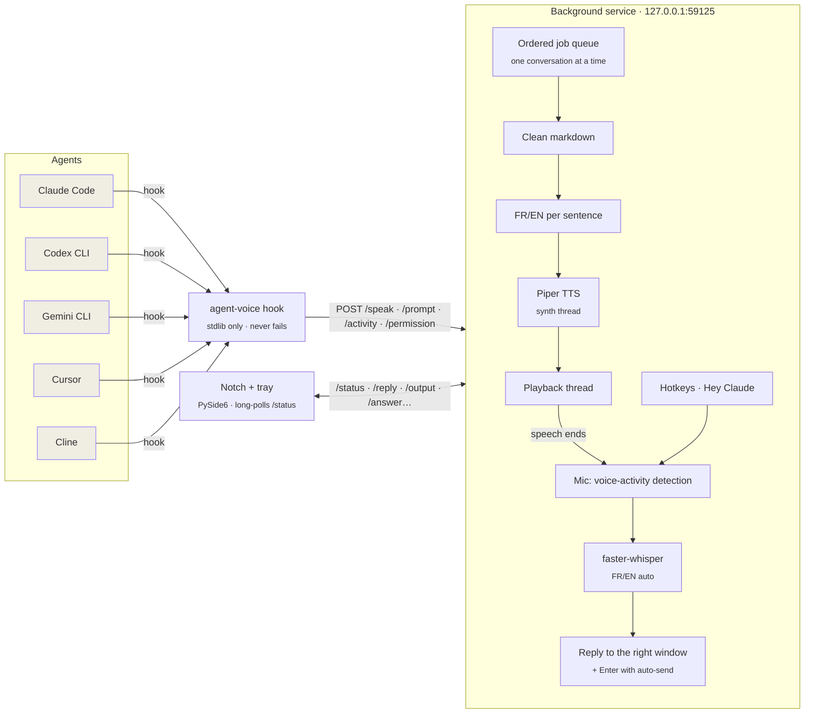
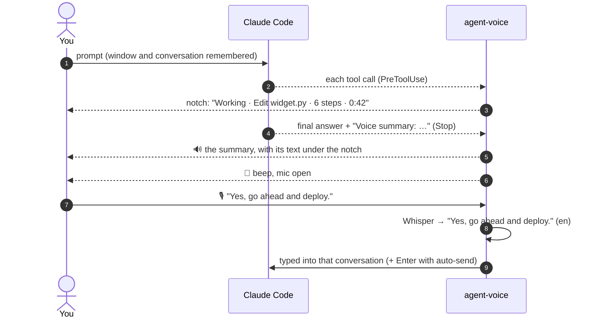

<p align="center">
  
</p>

<p align="center">
  <b>Hear your AI coding agent. Answer it by voice. Follow it from a notch at the top of your screen.<br>French or English, 100% on your machine.</b>
</p>

<p align="center">
  
  
  
  
  
</p>

<p align="center">
  <a href="#-quick-start">Quick start</a> ·
  <a href="#-the-notch">The notch</a> ·
  <a href="#-talking-to-your-agents">Talking to your agents</a> ·
  <a href="docs/guide.md">User guide</a> ·
  <a href="#-how-it-works">How it works</a> ·
  <a href="AGENTS.md">AGENTS.md</a>
</p>

---

**agent-voice** gives your coding agents a voice and ears. When Claude Code (or Codex, Gemini CLI, Cursor, Cline) answers, you **hear** it in a natural French or English voice, and **read along** under a black notch at the top of your screen. While it works, the notch shows what it's doing. When it's done, the mic opens: **just talk**, and your reply goes back to the right conversation, sent for you if you like.

Everything runs **locally on the CPU**: no cloud, no API key, no audio leaving your laptop. It's built to sip battery: nothing redraws or polls while nothing happens.

<p align="center">
  
  <br><sub>One turn: the agent works → reads its answer → the mic opens → you reply → the notch tucks itself away.</sub>
</p>

## ✨ Highlights

| | |
|---|---|
| 🗣️ **Speaks every reply** | Final answers and the progress notes between tool calls, never twice. Markdown, code and paths are cleaned out so it sounds natural. |
| 📖 **Read along** | The text being spoken hangs under the notch, from the sentence you're hearing, and leaves when the voice stops. |
| ⏱️ **Live activity** | While an agent works: *Working · Edit widget.py · 14 steps* and a timer, like a Dynamic Island. |
| 📝 **Summaries, not essays** | Long answers become one sentence (Claude Code is asked for a `Voice summary:` line). Full answers are one click away. |
| 🎙️ **Answer by voice** | After the answer, a beep and the mic opens. Talk, pause, done: Whisper transcribes and your reply is typed (and sent, with auto-send) into the conversation it answers. |
| 🧵 **Several conversations** | Each one has its colour, its own voice pitch and its own window; a second one waits its turn and is announced by name. |
| 🔔 **Voice, Chimes or Silent** | In the office: a soft chime and the reply as a banner. In a call: chimes, automatically. |
| ✅ **Approvals & questions** | Claude's permission prompts and multiple-choice questions, read out and shown in the notch: say *"yes"* or *"the second one"*, or click. |
| 👋 **"Hey Claude"** | Optional wake word: *"Hey Claude, run the tests"* sends a new prompt, hands-free. |
| 🇫🇷 🇬🇧 **Bilingual** | Each sentence is read by the matching voice; Whisper detects which language you speak. |
| 🔒 **Private, light, safe** | 100% offline; a local API that web pages can't reach; hooks that never break your agent. |

## 🚀 Quick start

### Download (Windows, no Python needed)

1. Get **`agent-voice-windows-x64.zip`** from the [latest release](https://github.com/ElMastho/agent-voice/releases/latest) and extract it anywhere (e.g. `C:\Tools\agent-voice`).
2. Double-click **`agent-voice.exe`**. The first run downloads the voices and the speech-recognition model (~600 MB), connects the agents it finds and starts the notch.
3. Optional: `agent-voice.exe autostart on` (or tray icon → *Start with Windows*).

Hooks point at the folder you extracted to: if you move it, double-click `agent-voice.exe` again. You can also connect an agent later from the notch: expand it and click the agent in the **Agents** row.

### From source

> Windows 11 · Python 3.13 recommended (some audio/ML wheels lag behind the newest Python).

```bash
git clone https://github.com/ElMastho/agent-voice.git
cd agent-voice
py -3.13 -m venv .venv
.venv/Scripts/pip install -e .
.venv/Scripts/agent-voice setup              # config + voices + speech-recognition model (~600 MB)
.venv/Scripts/agent-voice install claude     # or: codex gemini cursor cline | all
.venv/Scripts/agent-voice autostart on       # start with Windows (service + notch + tray icon)
.venv/Scripts/agent-voice start
```

Then open a **new** Claude Code session and ask it anything. You'll see it work in the notch, hear the answer, then a beep: reply out loud. The full walkthrough is in the **[user guide](docs/guide.md)**.

## 🏝️ The notch

agent-voice lives in a pure-black island at the top centre of your screen. At rest it tucks itself away, leaving a 3-pixel line: touch the top edge with the mouse to bring it down. It drops down on its own when something happens, and goes back up 3 seconds after.

<p align="center">
  
</p>

| State | What you see | Main button |
|---|---|---|
| **Ready** | A slate dot and what you said last | 🎙️ talk now |
| **Working** | Three dots ticking in the conversation's colour, the current step, a timer, *+1 working* for the others | 🎙️ talk now |
| **Speaking** | Bars following the voice, a violet light running around the edge, the language | ⏭️ skip & answer |
| **Hearing you** | Bars following your voice level, a green edge light; *Auto* when replies are sent for you | ⏹️ cancel |
| **Transcribing** | A spinning amber arc; *+1 waiting* when another conversation is next | — |
| **In a call** / **Chime** / **Silent** | A chip saying which mode you're in | 🎙️ talk now |

The edge light only shows while the voice or the mic is live: it doubles as a "mic on" signal.

### Read along

<p align="center">
  
</p>

While a reply is read out, its text hangs under the notch, starting at the sentence you're hearing, and disappears when the voice stops. Swipe it up to hide it for this reply; click it to open the conversation. (`read_along: false` turns it off.)

### Chimes and Silent: the reply as a banner

<p align="center">
  
</p>

In **Chimes** (a soft sound) or **Silent** (no sound at all), nothing talks, not even a setting change. Each finished reply drops down as a banner for about 5 seconds: hover to keep it, swipe it up to dismiss it, click it to open the conversation. While **another app holds the mic** (Teams, Zoom, Meet...), agent-voice switches to chimes by itself and back when the call ends; pick *Voice* during the call to override it.

### Every action, one click away


Open the chevron for the full panel:

- **Actions** with their shortcuts: reply now, hold to talk, stop, auto-send, silent, read selection, *Hey Claude*, approvals, summaries, and the last reply's **Replay**, **Copy** and **Open chat**. Buttons that only matter for the voice hide themselves in Chimes and Silent.
- **Speed** (1× to 2×) and **Mode**: *Voice / Chimes / Silent*.
- **Threads**: your recent conversations, what each is doing (*working*, *speaking*, *asks you*, *needs approval*, *next up*) and the start of its last reply, with replay and copy. Click one to open it.
- **You said**: the last 5 things it heard from you; click to copy.
- **Agents**: which agents are connected (green dot). Click one that isn't to connect it, or **?** for the setup guide.

The notch **never takes keyboard focus**, so your dictated reply still lands in the right window. It stays above your other windows.

<br clear="right">

### Prefer a floating bar?

<p align="center">
  
</p>

Right-click the notch → *Notch* to switch to a floating acrylic bar you can drag anywhere (it snaps to edges and remembers its place), or *Compact* for just the animated orb. `Ctrl+Alt+W` or a click on the tray icon shows / hides it.

## 💬 Talking to your agents

- **Reply**: after each answer the mic opens for 15 s (`Ctrl+Alt+A` to skip the voice and answer right away). Your reply goes to the window and the conversation it answers, even if it's minimized or another app is in front; once sent, you're returned to where you were. In the **Claude desktop app**, with auto-send on, it's sent **without bringing the app forward**. The text also stays on the clipboard.
- **Auto-send** (`Ctrl+Alt+H`): your spoken replies are submitted for you.
- **Push-to-talk** (hold `Ctrl+Alt+Space`): dictate into any app.
- **Voice commands** in the reply window: *"repeat that"*, *"slower"*, *"faster"*, *"never mind"* (or *"répète"*, *"plus lentement"*, *"plus vite"*, *"annule"*) drive agent-voice instead of being sent.
- **Approvals**: when Claude Code asks to run a command or edit a file, the request is read out and shown with *Allow once* / *Deny*. Say *"yes"* / *"no"* (*"oui"* / *"non"*) or click; with no answer within a minute, Claude shows its own dialog. Voice never grants more than once.
- **Questions**: when the agent asks you to choose (Claude Code's questions, Cline's follow-ups), the options appear in the notch and are read out. Click one or say it: *"the second one"*, *"option 3"*, or its name; anything else is sent as your own answer.
- **Several conversations**: when a second one finishes while another is talking (or waiting for you), it waits its turn and is announced by name. Each speaks a little lower or higher than the others (`thread_voices`), so you can tell them apart without looking.
- **Hey Claude** (off by default, toggle in the panel): while idle, *"Hey Claude, run the tests"* is sent to your last conversation as a new prompt; *"Hey Claude"* alone opens the mic. A 3.3M-parameter keyword spotter ([sherpa-onnx](https://github.com/k2-fsa/sherpa-onnx)) listens only while someone speaks, so it costs next to nothing; short phrases it misses (an accent it doesn't know: "Klod") get a quick check by Whisper tiny, and Whisper confirms every phrase before anything is sent.
- **Read anything aloud**: select text in any app and press `Ctrl+Alt+R` (handy for Antigravity or any tool without hooks).
- **Updates**: when a newer release is on GitHub, the tray menu offers it and the notch shows an *Update* chip.

## ⌨️ Shortcuts

| Keys | Action |
|---|---|
| `Ctrl+Alt+A` | **Reply now**: stop the voice and listen for your answer |
| `Ctrl+Alt+Space` *(hold)* | **Push-to-talk** in any window |
| `Ctrl+Alt+S` | **Stop** speaking / listening |
| `Ctrl+Alt+H` | **Auto-send** on/off |
| `Ctrl+Alt+C` | **Chimes** on/off |
| `Ctrl+Alt+M` | **Silent** on/off |
| `Ctrl+Alt+R` | **Read** the selected text aloud |
| `Ctrl+Alt+W` | **Show / hide** the notch |

All of them can be changed in `~/.agent-voice/config.json`.

## 🤖 Supported agents

| Agent | Integration | Install |
|---|---|---|
| **Claude Code** (CLI, desktop, IDE) | `Stop`, `PreToolUse`, `UserPromptSubmit`, `Notification` and `PermissionRequest` hooks: progress, live activity, final answer, questions, approvals | `agent-voice install claude` |
| **Codex CLI** | top-level `notify` in `~/.codex/config.toml` | `agent-voice install codex` |
| **Gemini CLI** | `AfterAgent` hook in `~/.gemini/settings.json` | `agent-voice install gemini` |
| **Cursor** | `afterAgentResponse` in `~/.cursor/hooks.json` | `agent-voice install cursor` |
| **Cline** | Hook scripts in `~/Documents/Cline/Hooks` (`.ps1` on Windows): completions, follow-up questions with their options, plan replies | `agent-voice install cline`, then Cline settings → *Enable Hooks* |
| **Antigravity** / anything else | select + `Ctrl+Alt+R`, or `echo text \| agent-voice say` | none needed |

Or click the agent in the notch's **Agents** row. Installers back up the file they touch (`*.bak-agent-voice`), are idempotent, and `agent-voice uninstall <agent>` reverts them.

## 🧠 How it works





## ⚙️ Configuration

`~/.agent-voice/config.json` (created by `agent-voice setup`, merged over defaults):

| Key | Default | Meaning |
|---|---|---|
| `voices.en` / `voices.fr` | `en_US-hfc_male-medium` / `fr_FR-siwis-medium` | Any [Piper voice](https://huggingface.co/rhasspy/piper-voices); `name:speaker` for multi-speaker models. Downloaded on first use |
| `speed` | `0.67` | Piper length scale: `1.0` normal, lower is faster (the panel's speed overrides it) |
| `max_chars` | `1500` | Long replies are cut at a sentence boundary |
| `speak_progress` | `true` | Also speak Claude's messages between tool calls |
| `summary` | `enabled: true`, `max_chars: 280` | One-sentence summaries of final answers (runtime toggle in the panel) |
| `read_along` | `true` | Show the text being spoken under the notch |
| `thread_voices` | `true` | Each conversation speaks slightly lower or higher than the others |
| `auto_chime_in_calls` | `true` | Chimes instead of the voice while another app uses the microphone |
| `auto_listen` | `enabled`, 15 s window, 1.5 s silence, 600 s max | Mic after the final answer |
| `permissions` | `enabled: true`, `wait_seconds: 60` | Approvals by voice / notch, and how long Claude waits before its own dialog |
| `wake_word` | `phrases: [hey claude, ok claude, …]` | Phrases accepted when Whisper confirms a keyword-spotter hit |
| `background_send` | `true` | Claude desktop app: send replies without bringing the window forward |
| `update_check` | `true` | Look for a newer release on GitHub at start |
| `chime.volume` | `0.35` | Chime loudness (0 to 1) |
| `stt.model` | `small` | Whisper size: `base` is faster, `small` is better in French |
| `widget` | `enabled: true`, `blur: "acrylic"` | `blur` (floating bar only): `acrylic` / `blur` / `none` |
| `hotkeys.*` | see above | Any [keyboard](https://github.com/boppreh/keyboard) combination |

Restart after editing: `agent-voice shutdown && agent-voice start`.

## 🧰 Commands

```text
agent-voice start | shutdown | status          run / stop / inspect the background service
agent-voice say "text" [--lang fr|en] [--voice NAME]
agent-voice stop | mute [on|off|toggle] | unmute | handsfree [on|off|toggle] | summary [on|off|toggle] | speed [1-2]
agent-voice chime [on|off|toggle]               chimes instead of the voice
agent-voice wake [on|off|toggle]                "Hey Claude, ..." sends a new prompt while idle
agent-voice widget                              reopen the notch + tray icon
agent-voice install | uninstall [claude codex gemini cursor cline | all]
agent-voice autostart on|off                    start with Windows
agent-voice setup                               config, voices, Whisper model
agent-voice serve                               run in the foreground (debugging)
```

## 🔒 Privacy, security, battery

- **Offline by design**: text-to-speech, transcription, language detection and the wake word run locally. Audio never leaves the machine. The only network calls are the model downloads on first use and the optional release check.
- **Calls**: detected from Windows' own privacy records of which app uses the mic; no audio is touched.
- **Local API only**: the service listens on `127.0.0.1` and rejects any request carrying an `Origin` header, a foreign `Host` (DNS rebinding) or a non-JSON body. Web pages can't drive it.
- **Agent-safe**: hooks are stdlib-only, time-boxed and swallow their own errors. A voice problem never breaks your agent.
- **Battery first**: ONNX Runtime never busy-waits; the wake word runs a volume gate before its tiny model; at rest the notch doesn't redraw and asks for status only when something changes.

## 🧪 Development

```bash
.venv/Scripts/pip install -e ".[dev]"
.venv/Scripts/python -m pytest -q             # unit tests (the daemon runs without audio or threads)
.venv/Scripts/agent-voice serve               # service in the foreground, logs in the console
.venv/Scripts/python scripts/render_docs.py   # regenerate these images and the GIF from the widget code
```

Architecture notes, invariants and gotchas for contributors (human or AI) are in **[AGENTS.md](AGENTS.md)**.

## 🙏 Built with

| Project | Role | License |
|---|---|---|
| [Piper](https://github.com/OHF-Voice/piper1-gpl) (`piper-tts`) | Neural text-to-speech | GPL-3.0-or-later |
| [Piper voices](https://huggingface.co/rhasspy/piper-voices) | Voice models (`hfc_male`, `siwis`…) | Per voice: see each model card |
| [faster-whisper](https://github.com/SYSTRAN/faster-whisper) | Speech-to-text | MIT |
| [CTranslate2](https://github.com/OpenNMT/CTranslate2) | Whisper inference engine | MIT |
| [OpenAI Whisper](https://github.com/openai/whisper) | Speech recognition model weights | MIT |
| [ONNX Runtime](https://github.com/microsoft/onnxruntime) | Runs the Piper models | MIT |
| [Lingua](https://github.com/pemistahl/lingua-py) | French/English detection | Apache-2.0 |
| [PySide6 / Qt](https://doc.qt.io/qtforpython-6/) | Notch, widget and tray icon | LGPL-3.0 |
| [sounddevice](https://github.com/spatialaudio/python-sounddevice) | Audio playback & recording | MIT |
| [keyboard](https://github.com/boppreh/keyboard) | Global hotkeys | MIT |
| [pyperclip](https://github.com/asweigart/pyperclip) | Clipboard | BSD-3-Clause |
| [sherpa-onnx](https://github.com/k2-fsa/sherpa-onnx) | "Hey Claude" keyword spotting (model downloaded on first use) | Apache-2.0 |
| [py3langid](https://github.com/adbar/py3langid) | Language detection in the Windows release (lingua is too large to bundle) | BSD-3-Clause |
| [comtypes](https://github.com/enthought/comtypes) | UI Automation: open the right conversation in the Claude desktop app | MIT |
| [NumPy](https://numpy.org) | Audio buffers | BSD-3-Clause |
| [Segoe Fluent Icons](https://learn.microsoft.com/windows/apps/design/style/segoe-fluent-icons-font) | Icons (system font, not redistributed) | Microsoft |

## 📄 License

Copyright © 2026 ElMastho.

agent-voice is free software: you can redistribute it and/or modify it under the terms of the **GNU General Public License v3.0 or later**. See [LICENSE](LICENSE). It is distributed in the hope that it will be useful, but **without any warranty**. GPL-3.0 is used because agent-voice builds on Piper, which is itself GPL-3.0. Voice models keep their own licenses.
